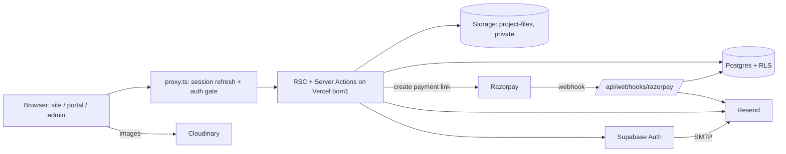

# Appamania — PRD and technical spec

| | |
|---|---|
| Version | 4.0 (supersedes v3 `docs/archive/PRD-v3.md` and tech doc v1.0 of 3 Nov 2026) |
| Owner | Sumit Pal (sole engineer, sole admin) |
| Status | Approved for build on branch `dev` |
| Date | 3 Nov 2026 |
| Domain | appamania.in |
| Design | Chai Studio design system (https://claude.ai/artifact/CYSyudfHkf3RWWcTHKfS4w) and screens canvas (https://claude.ai/artifact/4v4M4LY9RLzpDxYGkjRmEZ). Taste rules: `docs/design-brief.md` |

**How v4 was made.** Tech doc v1.0 wins on product (offers, pages, portal and admin features).
PRD v3 wins on safety (gapless invoice numbers, `is_admin()` with `aal2` and status, no finance
hard-deletes, pgTAP RLS gate, token lint). Where v4 is silent, v3 is **not** automatically in force:
stop and ask.

**Conventions.** Money is integer minor units (paise) in code and DB. "Admin" = Sumit. "Client" =
an invited user who belongs to a client company. MUST/SHOULD/MAY per RFC 2119.

## Section map

| § | Purpose | Used in step |
|---|---|---|
| 1–3 | Summary, offers and prices, goals | D2, all scoping |
| 4 | Epics and acceptance criteria | Every step |
| 5 | Non-functional requirements | All |
| 6–8 | Design system, tokens, components | D1, D2, D4, D5 |
| 9–11 | Stack, architecture, code structure | D1 |
| 12 | Auth and roles | D1 |
| 13 | Data model | D1 (all tables), D3 (invoicing functions) |
| 14 | RLS and storage policies | D1, D4 |
| 15 | Files and media | D4 |
| 16 | Payments and invoicing | D3 |
| 17 | Email | D2, D3, D4 |
| 18 | Lead capture | D2 |
| 19 | Server actions and routes | D3–D5 |
| 20 | Reports | D5 |
| 21–25 | Env, security, testing, CI/CD, ops | D1, D6 |
| 26–28 | Delivery plan, risks, decision log | Planning |
| App. A | Open items | All |

---

# Part I — Product

## 1. Summary

Appamania is a one-person senior Flutter studio from Kolkata. Positioning line:
**Flutter app rescue, migration and launch. Fixed price. Code you own.**

One Next.js codebase serves three surfaces:

| Surface | Path | Who | Theme |
|---|---|---|---|
| Marketing site | `/` | Public | Night (fixed) |
| Client portal | `/portal` | Invited clients | Light/Dark toggle, default Dark |
| Admin | `/admin` | Sumit only (MFA) | Light/Dark toggle, default Dark |

## 2. Offers and prices

INR only for now. Target buyer: small businesses and early founders. Every price ends in 9
(CI test on `config/offers.ts`).

| ID | Offer | Scope | Time | Price | Payment |
|---|---|---|---|---|---|
| `audit` | App Health Audit | Written report: architecture and state, crash root causes, startup/jank/memory, Flutter and package debt, store compliance, fixed-price fix plan | 48 hours | **₹2,999** | 100% upfront, self-serve (Razorpay Payment Page) |
| `sprint` | Rescue and Migration Sprint | SDK upgrade (Flutter, Dart, Gradle, Xcode, UIScene, Swift PM), root-cause crash fixes, GitHub Actions CI/CD, Play Store and App Store release, written handover | 3–4 weeks | **₹24,999** | 50% to start, 50% on release (invoice + payment link) |
| `retainer` | Care Retainer | Up to 8 hours a month: OS/SDK/package/policy updates, one release a month; no rollover | Monthly | **₹14,999 / month** | Monthly in advance (invoice + payment link); cancel anytime |
| `mvp` | MVP build | Enquiry only | — | From ₹74,999 | Proposal |
| `website` | Business website | Enquiry only | — | From ₹14,999 | Proposal |
| `custom` | Change request / other | Quoted per change request | — | Quote | Invoice |

**Rules**
- Audit fee is credited in full if the client starts a Sprint within 30 days. Admin issues the
  Sprint deposit invoice for the reduced amount (no negative line items).
- Retainer stays at or under ₹15,000 so it can later move to UPI Autopay without extra
  authorisation (Razorpay Subscriptions are out of v1; see §27).
- No GST is charged until registration. Prices are shown without "+ GST" until then.
- Offer names, prices, durations and milestone templates live only in `config/offers.ts`.
- Site constants (contact email, WhatsApp, availability line, conflict industries) live only in
  `config/site.ts`.

**Published terms (on `/services` and `/legal/terms`)**
1. Fixed price against written scope. Out-of-scope work is a change request, quoted before work.
2. All work happens in the client's repository. Code and IP belong to the client on payment.
3. Client owns all third-party accounts (stores, Firebase, Supabase); Appamania is invited.
4. NDA on request, before repo access.
5. Refunds: Audit refundable in full before work starts. Sprint: pro-rata for undelivered milestones.
6. Communication: daily WhatsApp update during a sprint, one weekly call, email for anything formal.

### 2.1 Employment-conflict guardrail (kept from v3 §4.6)
Industry is required on every enquiry. An industry in `site.conflictIndustries` auto-declines the
lead (`stage = 'declined_auto'`, polite reply, no call link). Admin override needs a reason and is
audit-logged. Launch blocker: written HR clarification (App. A, A5).

## 3. Goals, non-goals, metrics

**Goals**
- G1 Sell fixed-price offers and collect money online.
- G2 One place for the client: progress, milestones, updates, change requests, files, builds, invoices.
- G3 One place for the admin: leads, projects, invoices, receivables, income/GST-threshold/44ADA numbers.
- G4 Zero cross-client data exposure.
- G5 Run under ₹3,000/month infrastructure until revenue justifies more; maintainable at 10–15 h/week.

**Non-goals (v1):** multi-admin, chat, time-tracking UI, GST invoices (until registered),
multi-currency accounting, subscriptions/autopay, automatic client onboarding after self-serve
payment, refunds via API (handled in Razorpay dashboard, recorded manually), expenses ledger,
native admin app.

| Metric | Target (first 6 months) | Source |
|---|---|---|
| Median time to first reply on a lead | < 1 business day | `leads.first_reply_at` |
| Audit → Sprint conversion | ≥ 30% | `leads`, `projects` |
| Days sales outstanding | < 10 days | `invoices`, `payments` |
| RLS isolation incidents | 0 | pgTAP + E2E |
| Home Lighthouse mobile | Performance ≥ 90, Accessibility 100 | CI |

## 4. Epics and acceptance criteria

Priority: **M** must (launch), **S** should (within 4 weeks of launch), **C** could.

### E1 Marketing site (D2)
| # | Story | P | Acceptance criteria |
|---|---|---|---|
| E1.1 | Prospect understands offer in 5 s | M | Home hero: availability chip, headline, lead line, "Book a ₹2,999 audit" primary CTA, "See the work" secondary, 3 trust numbers, two phone mockups (sample audit, sprint checklist) |
| E1.2 | Home tells the story | M | Order: hero → tech marquee → 01 bento → 02 pricing → 03 case panel → 04 process → 05 quotes → 06 FAQ → green CTA → footer (canvas board `Main`) |
| E1.3 | Compare offers | M | `/services`: Audit, Sprint, Retainer sections, compare table, enquiry-only line for MVP/website, terms and refund policy |
| E1.4 | Read case studies | M | `/work` index + `/work/[slug]` MDX; each has problem, role, stack, result line with a real number |
| E1.5 | See apps and packages | M | `/apps` (live Play apps) and `/open-source` (pub.dev packages with points); content in MDX/config |
| E1.6 | Contact or book | M | `/contact` lead form (§18) plus "Pay ₹2,999 and book audit" button to the Razorpay Payment Page; WhatsApp and email links |
| E1.7 | Legal pages | M | `/legal/privacy`, `/legal/terms`, `/legal/refunds` (required by Razorpay) |
| E1.8 | Old URLs keep working | M | 301: `/studio` → `/apps`, `/studio/*` → `/apps`, `/oss/*` → `/open-source` |
| E1.9 | Client finds login | M | "Client login" in footer and mobile menu |
| E1.10 | Not found | M | Branded 404 (canvas board `NotFound`) |
| E1.11 | AI and search visibility | M | Metadata per page, OG images, `sitemap.ts`, `robots.ts`, `public/llms.txt`, JSON-LD `ProfessionalService` + `Person` + `Offer` (INR) |

### E2 Leads (D2 intake, D5 pipeline)
| # | Story | P | Acceptance criteria |
|---|---|---|---|
| E2.1 | Submit enquiry | M | Fields §18.2; zod; Turnstile verified server-side; honeypot; rate limit 5/hour per IP hash and 1 per 10 min per email |
| E2.2 | Instant acknowledgement | M | `LeadAck` within 1 minute; conflict variant has no call link |
| E2.3 | Admin alerted | M | `LeadAlert` with all fields and conflict flag |
| E2.4 | Paid audit becomes a lead | M | Payment Page webhook creates lead `need='audit'`, `stage='won'`, `source='audit_page'` and a `payments` row (kind `audit_page`); idempotent on payment ID |
| E2.5 | Admin works the pipeline | M | `/admin/leads` kanban by stage with drag (dnd-kit) and a stage `<select>` fallback; age badge warning at 24 h, danger at 48 h for `new` |
| E2.6 | Mark replied | M | Sets `first_reply_at` once |
| E2.7 | Override auto-decline | M | Reason required; audit-logged; stage → `new` |
| E2.8 | Convert lead | M | Creates client + project + milestones from offer template; lead `client_id` set, stage `won`; an `audit_page` payment gets attached to the project's first invoice |

### E3 Auth (D1)
| # | Story | P | Acceptance criteria |
|---|---|---|---|
| E3.1 | Nobody self-registers | M | Supabase sign-ups disabled (email and OAuth); no sign-up link; pgTAP/E2E proves an uninvited Google account gets no session |
| E3.2 | Client signs in | M | Magic link or Google at `/portal/login`; lands on `/portal` |
| E3.3 | Admin signs in with MFA | M | Magic link or Google, then TOTP; admin routes and `is_admin()` require `aal2` |
| E3.4 | Admin invites client user | M | `inviteUserByEmail` via server action; `client_members` row; audit entry |
| E3.5 | Offboard / reactivate client | M | Typed-name confirm; client + member profiles `offboarded`; users banned; access lost immediately (RLS helpers check status); unpaid invoices stay open. Reactivate reverses |

### E4 Client portal (D4)
| # | Story | P | Acceptance criteria |
|---|---|---|---|
| E4.1 | Overview | M | Active project card: status, progress %, next milestone and date, items needing client action, latest update, outstanding amount (canvas `ClientDashboard`) |
| E4.2 | Milestones | M | Ordered list with status and due date; progress = done/total unless admin override |
| E4.3 | Updates | M | Feed of client-visible updates, newest first; "needs your action" flag highlighted (canvas `ClientUpdates`) |
| E4.4 | Change requests | M | Client creates request (title, details, priority); sees status and quote; approves or declines a quote |
| E4.5 | Files and builds | M | List by kind; download via 10-minute signed URL; client uploads (≤ 50 MB, allow-listed extensions) into own project; expired builds hidden (canvas `ClientFiles`) |
| E4.6 | Invoices | M | List with status, amount, due date, derived overdue; "Pay" opens Razorpay link; PDF download (canvas `ClientInvoices`) |
| E4.7 | Isolation | M | pgTAP + E2E: client A sees nothing of client B, no drafts, no hidden updates, no leads, no admin notes |
| E4.8 | Theme | M | Light/Dark toggle persisted; no flash before paint |
| E4.9 | Mobile | M | Sidebar becomes bottom tab bar under 900 px; 44 px targets |

### E5 Admin (D3, D5)
| # | Story | P | Acceptance criteria |
|---|---|---|---|
| E5.1 | Dashboard | M | Receivables, overdue count, active projects, leads needing reply, this FY receipts (canvas `AdminDashboard`) |
| E5.2 | Projects | M | Create from offer; edit milestones (CRUD, reorder, complete); post update (markdown, client-visible, needs-action, notify email); upload files/builds; quote change requests (canvas `AdminProjects`) |
| E5.3 | Invoices | M | Draft with line items → send (number assigned, payment link created, email sent) → paid by webhook; manual "Mark paid" (bank/UPI/Wise with reference); void (keeps number) (canvas `AdminInvoices`) |
| E5.4 | Reports | M | Per FY: gross receipts, quarterly split, Razorpay fees, 44ADA deemed profit (50%), GST threshold meter vs ₹20,00,000, receivables; CSV export of receipts (canvas `AdminReports`) |
| E5.5 | Audit log | M | Onboard/offboard, invite, overrides, invoice send/void, manual payments, change-request quote |

## 5. Non-functional requirements

| Area | Requirement |
|---|---|
| Performance | Home LCP < 2.5 s (4G), CLS < 0.1, INP < 200 ms. Portal TTFB < 500 ms from India |
| Security | RLS on every table; MFA for admin; service-role key and secrets never in client bundles |
| Privacy | Minimal PII; no third-party trackers beyond Vercel Web Analytics; Supabase Mumbai |
| Accessibility | WCAG 2.2 AA; keyboard complete; visible focus; targets ≥ 44 px on touch |
| Browsers | Last 2 versions of Chrome, Safari, Firefox, Edge; iOS Safari 16+ |
| Responsive | 360–1920 px |
| Retention | Finance rows never hard-deleted; non-converted leads purged after 24 months |
| Maintainability | One repo, TypeScript + SQL, no bespoke infra |

---

# Part II — Design system

## 6. Source and principles

Chai Studio is the only design source. Tokens, type, radii, shadows and component rules come from
the design-system artifact; page composition comes from the canvas boards. `docs/design-brief.md`
holds taste rules and banned patterns.

Principles: proof over promise (the audit report is the hero); one primary action per view;
tokens or nothing (CI bans raw hex and default Tailwind palette outside `styles/`); native first
(`<details>`, `<dialog>`, `<input type="date">`); accessible by default.

## 7. Tokens

`styles/tokens.css` is the code copy of the design system's `tokens.json`. Three themes on
`<html data-theme>`: `night` (site, fixed), `dark` and `light` (portal/admin toggle, default
`dark`). Print and PDF use `light`.

| Token | night | light | dark | Use |
|---|---|---|---|---|
| `paper` | #070B09 | #F6F2EA | #0F1512 | Page background |
| `paper-raised` | #0D1411 | #FFFDF8 | #17201B | Cards, inputs, nav on scroll |
| `paper-sunken` | #050807 | #EDE6DA | #0B100D | Code, footer band |
| `ink` | #EEF2EC | #16231C | #EEF2EC | Text |
| `ink-muted` | #A3B0A8 | #4A5A52 | #A9B5AE | Secondary text |
| `line` | #1A221E | #DDD4C4 | #2A3530 | Hairlines (decorative) |
| `line-strong` | #5F6E66 | #7F786A | #62706A | Control borders (≥ 3:1) |
| `brand` | #3DDC84 | #1F5C43 | #5FBF8F | Primary action, links, mark |
| `brand-hover` | #5BE89A | #17473A | #7DD0A6 | Hover |
| `on-brand` | #04130A | #F6F2EA | #0F1512 | Text on brand |
| `brand-tint` | #12301F | #D9E6DE | #1C3328 | Badges, selected rows, featured plan |
| `saffron` | #ECBC55 | #ECBC55 | #ECBC55 | Spark; fill only, never text on paper |
| `on-saffron` | #16231C | #16231C | #16231C | Text on saffron |
| `saffron-tint` | #2E2612 | #F7E7C2 | #3A2F14 | Soft highlight |
| `danger` | #F08A75 | #B3412E | #F08A75 | Errors, destructive |
| `focus` | = brand | = brand | = brand | 2 px ring, 2 px offset |
| `night` | #0D1411 | #10201A | #070B09 | Bento tiles (night) / inverse band (light) |
| `on-night` / `on-night-muted` | #EEF2EC / #A3B0A8 | #EEF2EC / #A9B5AE | #EEF2EC / #A9B5AE | Text on night |
| `score-good` / `score-warn` / `score-bad` | #3DDC84 / #ECBC55 / = danger | #2E7D57 / #9A6A12 / = danger | #5FBF8F / #ECBC55 / = danger | Audit scores; always with label |

**Type.** Geist (all text) and Geist Mono (eyebrows, badges, prices, code) via `next/font/google`.

| Style | Size / line | Weight | Tracking | Use |
|---|---|---|---|---|
| `display-2xl` | clamp(56px, 8.4vw, 128px) / 0.92 | 600 | −0.055em | Home hero only |
| `display-xl` | 72/72 (mobile 44) | 600 | −0.03em | Inner page heroes |
| `display` | 44/48 | 600 | −0.045em | Page titles |
| `h1` | 32/38 | 600 | −0.045em | Section headings |
| `h2` | 24/30 | 600 | −0.03em | Card titles |
| `h3` | 18/26 | 600 | — | Small headings, FAQ |
| `body-lg` | 18/28 | 400 | — | Lead |
| `body` | 16/26 | 400 | — | Default |
| `small` | 14/22 | 400 | — | Helper, captions |
| `label` (mono) | 12/16 | 500 | 0.06em, uppercase | Eyebrows, badges |
| `code` (mono) | 14/22 | 400 | — | Code, prices, numbers in tables |

Portal/admin use the same styles from `display` down; `tabular-nums` on every number.

**Spacing:** 4, 8, 12, 16, 24, 32, 48, 64, 96, 128 px (`space-1` … `space-32`).
**Radius:** `sm` 12, `md` 20, `lg` 28, `xl` 40, `pill` 999.
**Shadow:** `shadow-card` (hover, featured), `shadow-glow` (night featured plan, one per page),
`shadow-hard` (light only, max two per page).
**Motion:** 150–200 ms ease-out, transform/opacity only, hover feedback and marquee only; marquee
pauses on hover/focus; everything off under `prefers-reduced-motion`.
**Icons:** lucide-react, stroke 1.75, 20 px default, `currentColor`. No emoji.

## 8. Components

`components/ui/` (shared): Button (pill; `primary` brand, `outline`, `ghost`, `danger`; sizes sm/md),
Input/Textarea/Select/Field (label above, error below with `aria-describedby`), Badge/StatusPill,
Card, Table (stacks below md), Dialog (native), Toast, Progress, Money, EmptyState, ThemeToggle.
`components/site/`: Navbar (floating pill, glass blur), Hero, PhoneMock, AuditCard, Marquee,
SectionHeader (numbered mono eyebrow), Bento, PricingCard, CasePanel, Steps, Quote, FAQ, CTABand,
Footer (outlined giant wordmark).
`components/portal/`: Sidebar/BottomTabs, Topbar, MilestoneList, UpdatesFeed, ChangeRequestList,
FileList, InvoiceTable, StatCard, LeadsBoard, Bar chart (CSS).

New visual pattern → add it to the design-system artifact and `components/` first, then use it.

**Status mapping** (label + icon always; colour never alone)

| Domain | Value | Label | Tone |
|---|---|---|---|
| Project | booked / active / on_hold / done / cancelled | Booked / Active / On hold / Done / Cancelled | neutral / brand / saffron / brand / neutral |
| Milestone | todo / active / done | To do / In progress / Done | neutral / saffron / brand |
| Invoice | draft / sent / partially_paid / paid / void / (derived) overdue | Draft / Sent / Partly paid / Paid / Void / Overdue | neutral / neutral / saffron / brand / neutral / danger |
| Change request | open / quoted / approved / declined / done | Open / Quoted / Approved / Declined / Done | neutral / saffron / brand / neutral / brand |
| Lead | new / contacted / call_booked / proposal_sent / won / lost / declined_auto | New / Contacted / Call booked / Proposal sent / Won / Lost / Auto-declined | saffron / neutral / neutral / neutral / brand / neutral / neutral |

**Copy:** sentence case; verb-first buttons; numbers over adjectives; no "please",
"successfully", "simply", "passionate", "cutting-edge", "seamless", "world-class", "leverage",
"solutions". Placeholders for missing facts look like `[CLIENT QUOTE]` and are listed by CI.

---

# Part III — Architecture

## 9. Stack

| Concern | Choice |
|---|---|
| Framework | Next.js 16 App Router, RSC, Server Actions, TypeScript strict |
| Styling | Tailwind CSS v4 mapped to tokens |
| Content | MDX in repo (`content/work`, `content/apps`, `content/open-source`) |
| DB, Auth, Storage | Supabase (Mumbai): Postgres + RLS, Auth (magic link, Google, TOTP), private Storage bucket |
| Payments | Razorpay Payment Links (invoices) + one static Payment Page (audit) + webhook |
| Email | Resend + React Email; Supabase Auth custom SMTP via Resend |
| Images | Cloudinary (public portfolio images) via `next/image` loader |
| Anti-spam | Cloudflare Turnstile + honeypot + rate limit |
| PDF | `@react-pdf/renderer` (invoice PDFs) |
| Theme | `next-themes` (portal/admin) |
| Drag | `@dnd-kit/core` (leads kanban) |
| Validation | zod |
| Icons | lucide-react |
| Tests | Vitest, Playwright + @axe-core/playwright, pgTAP |
| Errors | Sentry |
| Hosting | Vercel Pro, functions region `bom1` |
| Analytics | Vercel Web Analytics |
| CI | GitHub Actions |

Not used: ORM, global state library, UI kit, CSS-in-JS, animation library, date library, lodash,
axios, CMS, Supabase Edge Functions.

## 10. Architecture



- Reads in Server Components with the user's session; RLS is the boundary, layouts are UX.
- Service-role client only in the webhook route and admin-only server actions; module imports
  `server-only`.
- The `payments` row written by the verified webhook (or an audited manual entry) is the only
  source of truth for money received.
- Business rules that must not drift live in Postgres: invoice numbering, invoice totals, paid
  status, progress.

## 11. Code structure

```
app/
  (site)/            layout.tsx (data-theme="night")  page.tsx  services/  work/ work/[slug]/
                     apps/  open-source/  contact/  legal/{privacy,terms,refunds}/
  portal/            login/  layout.tsx (requireClient)  page.tsx  milestones/  updates/
                     requests/  files/  invoices/
  admin/             layout.tsx (requireAdmin + aal2)  page.tsx  leads/  clients/[id]/
                     projects/[id]/  invoices/[id]/  reports/  reports/export.csv/route.ts
  auth/callback/route.ts   api/webhooks/razorpay/route.ts   api/health/route.ts
  sitemap.ts robots.ts not-found.tsx layout.tsx globals.css
features/<name>/{actions.ts,queries.ts,schema.ts,components/}
  leads clients projects milestones updates change-requests files invoices payments reports
components/{ui,site,portal}/
config/offers.ts  config/site.ts
emails/*.tsx                        # React Email
lib/supabase/{server,browser,admin}.ts  lib/auth.ts  lib/money.ts  lib/dates.ts
lib/razorpay.ts  lib/email.ts  lib/cloudinary.ts  lib/turnstile.ts  lib/audit.ts  lib/env.ts
styles/tokens.css
supabase/migrations/*.sql  supabase/tests/*.test.sql  supabase/seed.sql
content/{work,apps,open-source}/*.mdx
public/llms.txt
tests/e2e/*.spec.ts  tests/fixtures/payment_link.paid.json
proxy.ts
```

Rules: feature-first, flat; no repository/service layers; every mutation is a Server Action with
zod `safeParse` returning `{ ok } | { fieldErrors } | { formError }`; amounts never come from the
request; format money only via `lib/money.ts`, dates only via `lib/dates.ts`.

## 12. Auth and roles

- Methods: email magic link and Google OAuth. No passwords. Admin adds TOTP; `aal2` required.
- Invite-only: "Allow new users to sign up" off in Supabase (blocks new OAuth users too). Redirect
  URLs allow-listed.
- `profiles.role` = `admin` | `client`; one admin row, set by SQL runbook.
- A trigger on `auth.users` insert creates the `profiles` row (invites are the only way in).
- `proxy.ts` refreshes the session and redirects unauthenticated `/portal/*` (except
  `/portal/login`) and `/admin/*` to `/portal/login`.
- `lib/auth.ts`: `requireClient()` (active client member) and `requireAdmin()` (admin + `aal2`,
  else redirect to the TOTP step). Every admin server action calls `requireAdmin()`.

## 13. Data model

Migrations are forward-only, numbered. Every table ships with RLS enabled, policies and pgTAP tests.
`0001_core.sql`:

```sql
create type user_role        as enum ('admin','client');
create type account_status   as enum ('active','offboarded');
create type lead_stage       as enum ('new','contacted','call_booked','proposal_sent','won','lost','declined_auto');
create type offer_id         as enum ('audit','sprint','retainer','mvp','website','custom');
create type project_status   as enum ('booked','active','on_hold','done','cancelled');
create type milestone_status as enum ('todo','active','done');
create type invoice_status   as enum ('draft','sent','partially_paid','paid','void');
create type supply_type      as enum ('non_gst','intra_state','inter_state','export_lut','export_igst');
create type cr_status        as enum ('open','quoted','approved','declined','done');
create type cr_priority      as enum ('nice','sprint','urgent');
create type file_kind        as enum ('build','report','proposal','invoice','client_upload','other');
create type payment_source   as enum ('razorpay','bank_transfer','upi','wise','other');
create type payment_kind     as enum ('invoice','audit_page');

create table profiles (
  id         uuid primary key references auth.users on delete restrict,
  role       user_role not null default 'client',
  full_name  text,
  status     account_status not null default 'active',
  created_at timestamptz not null default now()
);

create table clients (
  id            uuid primary key default gen_random_uuid(),
  name          text not null,
  legal_name    text,
  billing_email text not null,
  phone         text,                       -- Razorpay customer contact
  country       char(2) not null default 'IN',
  state_code    char(2),                    -- for GST later
  gstin         text,
  address       text,
  industry      text not null,
  status        account_status not null default 'active',
  created_at    timestamptz not null default now(),
  offboarded_at timestamptz
);

create table client_notes (                 -- admin-only
  client_id  uuid primary key references clients on delete restrict,
  notes      text not null default '',
  updated_at timestamptz not null default now()
);

create table client_members (
  client_id  uuid references clients on delete restrict,
  profile_id uuid references profiles on delete restrict,
  primary key (client_id, profile_id)
);

create table leads (
  id                  uuid primary key default gen_random_uuid(),
  name                text not null,
  email               text not null,
  company             text,
  industry            text not null,
  need                offer_id,
  repo_url            text,
  message             text,
  source              text not null default 'site',   -- site | audit_page | linkedin | warm
  stage               lead_stage not null default 'new',
  conflict_flag       boolean not null default false,
  override_reason     text,
  value_minor         bigint,
  ip_hash             text,                            -- sha256(ip + LEAD_SALT)
  razorpay_payment_id text unique,                     -- audit_page idempotency
  first_reply_at      timestamptz,
  next_action_at      date,
  client_id           uuid references clients on delete restrict,
  created_at          timestamptz not null default now()
);

create table projects (
  id                uuid primary key default gen_random_uuid(),
  client_id         uuid not null references clients on delete restrict,
  title             text not null,
  offer             offer_id not null,
  status            project_status not null default 'booked',
  value_minor       bigint not null check (value_minor >= 0),
  start_date        date,
  due_date          date,
  hours_budget      int,
  progress_override smallint check (progress_override between 0 and 100),
  created_at        timestamptz not null default now()
);

create table milestones (
  id          uuid primary key default gen_random_uuid(),
  project_id  uuid not null references projects on delete restrict,
  position    int not null,
  title       text not null,
  description text,
  status      milestone_status not null default 'todo',
  due_date    date,
  done_at     timestamptz,
  unique (project_id, position) deferrable initially deferred
);

create table updates (
  id                  uuid primary key default gen_random_uuid(),
  project_id          uuid not null references projects on delete restrict,
  author_id           uuid references profiles,
  milestone_id        uuid references milestones on delete set null,
  body                text not null,
  client_visible      boolean not null default true,
  needs_client_action boolean not null default false,
  created_at          timestamptz not null default now()
);

create table change_requests (
  id          uuid primary key default gen_random_uuid(),
  project_id  uuid not null references projects on delete restrict,
  created_by  uuid not null references profiles,
  title       text not null check (length(title) between 3 and 140),
  details     text check (length(details) <= 4000),
  priority    cr_priority not null default 'sprint',
  status      cr_status not null default 'open',
  quote_minor bigint check (quote_minor > 0),
  quote_days  int check (quote_days > 0),
  decided_at  timestamptz,
  created_at  timestamptz not null default now()
);

create table files (
  id           uuid primary key default gen_random_uuid(),
  project_id   uuid not null references projects on delete restrict,
  uploaded_by  uuid not null references profiles,
  kind         file_kind not null,
  storage_path text not null unique,           -- '{project_id}/...' in bucket project-files
  file_name    text not null,
  size_bytes   bigint not null check (size_bytes between 1 and 52428800),
  expires_at   timestamptz,                    -- test builds
  created_at   timestamptz not null default now()
);

create table invoice_counters (fy text primary key, last_no int not null);   -- fy '26-27'

create table invoices (
  id                 uuid primary key default gen_random_uuid(),
  client_id          uuid not null references clients on delete restrict,
  project_id         uuid references projects on delete restrict,
  number             text unique,                -- null while draft; 'INV/26-27/001'
  title              text not null,
  status             invoice_status not null default 'draft',
  currency           char(3) not null default 'INR' check (currency = 'INR'),
  supply             supply_type not null default 'non_gst',
  total_minor        bigint not null default 0,  -- set by send_invoice()
  paid_minor         bigint not null default 0,  -- maintained by trigger
  issue_date         date,
  due_date           date,
  bill_to            jsonb,                      -- client snapshot at send
  razorpay_link_id   text unique,
  razorpay_short_url text,
  pdf_path           text,
  sent_at            timestamptz,
  paid_at            timestamptz,
  voided_at          timestamptz,
  created_at         timestamptz not null default now()
);

create table invoice_items (
  id               uuid primary key default gen_random_uuid(),
  invoice_id       uuid not null references invoices on delete cascade,  -- drafts only (guard trigger)
  position         int not null default 0,
  description      text not null,
  qty              numeric(10,2) not null default 1 check (qty > 0),
  unit_price_minor bigint not null check (unit_price_minor > 0),
  amount_minor     bigint generated always as (round(qty * unit_price_minor)::bigint) stored
);

create table payments (
  id                  uuid primary key default gen_random_uuid(),
  kind                payment_kind not null default 'invoice',
  invoice_id          uuid references invoices on delete restrict,
  lead_id             uuid references leads on delete restrict,
  source              payment_source not null,
  amount_minor        bigint not null check (amount_minor > 0),
  currency            char(3) not null default 'INR',
  fee_minor           bigint not null default 0,
  tax_on_fee_minor    bigint not null default 0,
  method              text,                         -- upi | card | netbanking | ...
  razorpay_payment_id text unique,                  -- webhook idempotency
  reference           text,                         -- UTR / Wise ref for manual entries
  paid_at             timestamptz not null,
  raw                 jsonb,                        -- admin-only column (see §14)
  created_at          timestamptz not null default now(),
  constraint payment_target check (invoice_id is not null or (kind = 'audit_page' and lead_id is not null)),
  constraint manual_has_ref check (source = 'razorpay' or reference is not null)
);

create table audit_log (
  id         bigint generated always as identity primary key,
  actor      uuid,
  action     text not null,
  entity     text not null,
  entity_id  uuid,
  diff       jsonb,
  created_at timestamptz not null default now()
);

create index on projects (client_id);
create index on milestones (project_id, position);
create index on updates (project_id, created_at desc);
create index on change_requests (project_id, created_at desc);
create index on files (project_id, created_at desc);
create index on invoices (client_id, status);
create index on payments (invoice_id);
create index on payments (paid_at);
create index on leads (stage, created_at desc);
create index on leads (ip_hash, created_at);
```

**Functions and triggers** (`0004_invoicing.sql`, D3; logic as v3 §34.2, adapted):
- `fy_label(d date)` → `'26-27'`, using the IST calendar date (`(now() at time zone 'Asia/Kolkata')::date`).
- `send_invoice(p_id uuid) returns text` — security definer, admin-only (`is_admin()`), one
  transaction: lock draft, require ≥ 1 item, `total_minor = sum(items)`, increment
  `invoice_counters` row for the FY (row lock = no gaps on rollback), number
  `'INV/' || fy || '/' || lpad(n, 3, '0')`, freeze `bill_to`, set `status = 'sent'`, dates, audit row.
- `guard_sent_invoice` trigger: after send, `client_id`, `total_minor`, `number`, `bill_to`,
  `supply`, `currency` are immutable; correct by void + new invoice. Items of non-draft invoices
  are immutable (`guard_items`).
- `sync_invoice_paid` trigger on `payments` insert/update: `paid_minor = sum(amount)` for that
  invoice; status `paid` (sets `paid_at`) when `paid_minor >= total_minor`, else `partially_paid`
  when > 0; `void` never changes.
- Overdue is derived: `status in ('sent','partially_paid') and due_date < IST today`. No cron.
- `project_progress` view (`security_barrier`, filtered by `is_admin() or client_id in my_client_ids()`):
  `coalesce(progress_override, round(100 * done / nullif(total, 0)), 0)`.
- Restrictive policies: no delete on `payments`, `audit_log`, `invoices` (except drafts),
  `invoice_counters`; no update on `audit_log`.

## 14. RLS and storage policies

Helpers (`0002_auth.sql`, as v3 §31.1):

```sql
create function public.is_admin() returns boolean
language sql stable security definer set search_path = '' as $$
  select exists (select 1 from public.profiles
                 where id = auth.uid() and role = 'admin' and status = 'active')
     and (auth.jwt() ->> 'aal') = 'aal2'
$$;

create function public.my_client_ids() returns setof uuid
language sql stable security definer set search_path = '' as $$
  select cm.client_id from public.client_members cm
  join public.profiles p on p.id = cm.profile_id
  join public.clients  c on c.id = cm.client_id
  where p.id = auth.uid() and p.status = 'active' and c.status = 'active'
$$;
```

Policies (`0003_rls.sql`; all `to authenticated`; API roles lose TRUNCATE/TRIGGER/REFERENCES):

| Table | Admin | Client |
|---|---|---|
| every table | `admin_all` (all, using/with check `is_admin()`) | — |
| profiles | | select own row |
| clients | | select where `id in my_client_ids()` |
| client_members | | select own rows |
| client_notes, leads, audit_log, invoice_counters | | none |
| projects | | select own clients' projects |
| milestones | | select via visible projects |
| updates | | select `client_visible` via visible projects |
| change_requests | | select via visible projects; insert with `created_by = auth.uid()`, `status = 'open'`, no quote, own project; update only `status` `quoted → approved/declined` on own project (via `decide_change_request()` security-definer function, not a direct update policy) |
| files | | select via visible projects and (`expires_at` null or future); insert with `uploaded_by = auth.uid()`, `kind = 'client_upload'`, own project, `storage_path` starting with `project_id || '/'` |
| invoices | | select `status <> 'draft'` and own client |
| invoice_items | | select via visible invoices |
| payments | | select via visible invoices — through view `client_payments` (no `fee_minor`, `tax_on_fee_minor`, `raw`); base table admin-only |

Clients read a storage object only if a visible `files` row points at it (expiry included). Client uploads go to `{project_id}/client_upload/{uuid}-{name}`; the `files` row may only reference an object the same user uploaded (`uploaded_by_me()`). `created_at` on client-insertable tables is stamped by trigger.

Storage bucket `project-files` (private, 50 MB limit, MIME allow-list: apk, aab, ipa, pdf, zip,
png, jpg, webp, txt, md, csv). Path `{project_id}/{kind}/{uuid}-{file_name}`.

```sql
create policy pf_read on storage.objects for select to authenticated using (
  bucket_id = 'project-files' and (public.is_admin() or
  (storage.foldername(name))[1]::uuid in
    (select id from public.projects where client_id in (select public.my_client_ids()))));
create policy pf_client_insert on storage.objects for insert to authenticated with check (
  bucket_id = 'project-files' and (storage.foldername(name))[2] = 'client_upload' and
  (storage.foldername(name))[1]::uuid in
    (select id from public.projects where client_id in (select public.my_client_ids())));
create policy pf_admin on storage.objects for all to authenticated
  using (bucket_id = 'project-files' and public.is_admin())
  with check (bucket_id = 'project-files' and public.is_admin());
```

## 15. Files and media

| What | Where | Access |
|---|---|---|
| Portfolio images, case-study screenshots, app icons | Cloudinary folder `appamania/` | Public; `f_auto,q_auto,w_…` via `next/image` loader |
| Builds, reports, proposals, invoice PDFs, client uploads | Supabase Storage `project-files` | Signed URL, 600 s, created by a server action with the **user's session client** (never service role), so storage RLS applies |

- Admin uploads to Cloudinary with a signed upload (`lib/cloudinary.ts`).
- Builds: optional CI upload from the client's repo with a scoped key → `files` row (kind `build`,
  `expires_at = now() + 14 days`). Daily `pg_cron` job deletes expired build objects and rows
  (D4, S priority).

## 16. Payments and invoicing

### 16.1 Flows
| Flow | Razorpay product | Trigger | Webhook | Result |
|---|---|---|---|---|
| A. Invoice | Payment Link | Admin sends invoice | `payment_link.paid` | `payments` row (kind `invoice`) → trigger sets paid |
| B. Audit self-serve | One static Payment Page (₹2,999, collects name, email, phone, repo URL) | Visitor pays | `payment.captured` with page notes `source = audit_page` (verify event shape in test mode, App. A A3) | Lead (`stage won`) + `payments` row (kind `audit_page`) in one RPC `record_audit_page(p_payment jsonb)`, idempotent on payment ID |
| C. Manual | none | Admin "Mark paid" | none | `payments` row, `source` bank_transfer/upi/wise/other, `reference` required, audit entry |
| D. Expired link | Payment Link | link expiry | `payment_link.expired` | Clear `razorpay_short_url`; admin can recreate |
| E. Refund | Dashboard | Admin refunds in Razorpay | not handled in v1 | Admin records manually (open item for v1.1) |

### 16.2 Payment link (`lib/razorpay.ts`, server-only)
POST `/v1/payment_links` with `amount = invoices.total_minor - paid_minor` read from DB,
`currency 'INR'`, `reference_id = invoices.number` (unique per link), `description`
`"{number} · {title}"`, `customer {name, email, contact}`, `notify {email:false, sms:false}`
(own emails), `reminder_enable true`, `notes {invoice_id}`, `callback_url`
`{SITE_URL}/portal/invoices?paid={number}` (informational only), `expire_by` = due date + 7 days.

### 16.3 Webhook (`app/api/webhooks/razorpay/route.ts`, Node runtime)
1. Read raw body; HMAC-SHA256 with `RAZORPAY_WEBHOOK_SECRET`; `timingSafeEqual`; 401 on mismatch.
2. Route by `event`. All writes via service role with `onConflict: 'razorpay_payment_id',
   ignoreDuplicates: true` or an idempotent RPC.
3. Amount recorded = gateway amount; the invoice match comes from `notes.invoice_id` **and** must
   equal the link stored on that invoice; mismatch → 200 + Sentry alert, no write.
4. Emails (`PaymentReceipt`, `PaymentAlert`) only on the first transition to paid, with Resend
   idempotency key = payment ID. Email failure never fails the webhook.
5. DB error → 500 so Razorpay retries.
Never mark paid from the callback URL.

### 16.4 Invoice PDF
`@react-pdf/renderer` in the send action; stored at `{project_id}/invoice/{number}.pdf` and a
`files` row (kind `invoice`). Light theme, A4. Title "Invoice" (non-GST). Footer: Appamania ·
Udyam [UDYAM no] · PAN [PAN] · "GST not applicable (unregistered)". No full bank account numbers
in emails.

## 17. Email

From `Appamania <hello@mail.appamania.in>`, reply-to `sumit@appamania.in`. `lib/email.ts` is the
only file that knows the provider; it logs and swallows send errors.

| Template | Trigger | To |
|---|---|---|
| `LeadAck` (+ conflict variant) | Lead submitted | Lead |
| `LeadAlert` | Lead submitted / audit page paid | Admin |
| `PortalInvite`, `MagicLink` | Supabase Auth templates (custom SMTP) | Client |
| `InvoiceSent` | Invoice sent | Client billing email |
| `PaymentReceipt` / `PaymentAlert` | First paid transition | Client / Admin |
| `PaymentReminder` | 3 days before due, on due, +3 days (daily `pg_cron` → Vercel cron route) | Client (S) |
| `ProjectUpdate` | Update posted with "notify" | Client members |
| `ChangeRequestNew` / `ChangeRequestQuoted` | Client creates / admin quotes | Admin / Client |
| `BuildReady` | Build file added | Client members (S) |

## 18. Lead capture

### 18.1 Flow
`/contact` → Server Action `createLead` → honeypot (pretend success) → zod → Turnstile verify →
rate limit (IP hash 5/hour, same email 1/10 min) → conflict check → insert via service role →
`after()`: `LeadAck`, `LeadAlert`.

### 18.2 Fields
| Field | Type | Required |
|---|---|---|
| name | text | yes |
| email | email | yes |
| company | text | no |
| industry | select (Fintech, E-commerce, Health, Education, Media, Games, Logistics, Real estate, SaaS / B2B, Other) | yes |
| need | radio: Audit, Sprint, Retainer, MVP, Website, Not sure | yes |
| repo_url | url | no |
| message | textarea, min 20 chars | yes |
| website | hidden honeypot | must be empty |

## 19. Server actions and routes

| Action / route | Role | Does |
|---|---|---|
| `createLead` | anon | §18 |
| `moveLead`, `markReplied`, `overrideDecline` | admin | Pipeline |
| `convertLead` | admin | Client + project + milestones from `config/offers.ts`; attach audit-page payment |
| `onboardClient`, `inviteClientUser`, `offboardClient`, `reactivateClient` | admin | E3 |
| `createProject`, `upsertMilestone`, `reorderMilestones`, `completeMilestone` | admin | E5.2 |
| `postUpdate` | admin | Insert + optional `ProjectUpdate` email |
| `createChangeRequest` | client | Insert + `ChangeRequestNew` |
| `quoteChangeRequest` | admin | Status quoted + email |
| `decideChangeRequest` | client | RPC; approved → admin sees "create invoice draft" action |
| `uploadFile`, `getSignedDownload` | both | §15 |
| `createInvoice`, `sendInvoice`, `recreatePaymentLink`, `markPaidManual`, `voidInvoice` | admin | §16 |
| `POST /api/webhooks/razorpay` | Razorpay | §16.3 |
| `GET /auth/callback` | Supabase | Exchange code, redirect by role (admin → TOTP step) |
| `GET /admin/reports/export.csv?fy=26-27` | admin | Receipts CSV |
| `GET /api/health` | public | `select 1`, 2 s timeout → `{"db":"ok"}` / 503 |

## 20. Reports

Views (`0005_reports.sql`, admin-only via `where public.is_admin()` filter, `security_barrier`):
- `v_receipts`: every payment with `fy` (`fy_label(paid_at IST date)`), `fy_quarter` (Q1 Apr–Jun …),
  client, invoice number or "Audit (page)", amount, fee, tax on fee, method, source.
- `v_fy_summary`: per FY gross, fees, net, `deemed_profit_44ada = gross / 2`, GST meter
  `gross / 20,00,000`.
- `v_receivables`: sent/partially paid invoices with balance and `days_overdue`.

CSV columns: date, invoice no, client, source, method, amount, fee, tax on fee, reference.
Tax numbers are planning aids; confirm with a CA.

---

# Part IV — Infrastructure

## 21. Environments and variables

| Env | Web | DB | Razorpay | Email |
|---|---|---|---|---|
| Local | `next dev` | `supabase start` + `seed.sql` | Test keys | Resend test / Inbucket |
| Preview | Vercel preview | Supabase staging (free) | Test keys | Resend, admin address only |
| Production | Vercel Pro `appamania.in`, `bom1` | Supabase Pro (Mumbai) once a paying portal client exists | Live keys | Resend live |

`.env.example` (validated at boot by `lib/env.ts` with zod):
```
NEXT_PUBLIC_SITE_URL=
NEXT_PUBLIC_SUPABASE_URL=
NEXT_PUBLIC_SUPABASE_ANON_KEY=
NEXT_PUBLIC_TURNSTILE_SITE_KEY=
NEXT_PUBLIC_CLOUDINARY_CLOUD_NAME=
NEXT_PUBLIC_AUDIT_PAGE_URL=
SUPABASE_SERVICE_ROLE_KEY=
RAZORPAY_KEY_ID=
RAZORPAY_KEY_SECRET=
RAZORPAY_WEBHOOK_SECRET=
RESEND_API_KEY=
TURNSTILE_SECRET_KEY=
CLOUDINARY_API_KEY=
CLOUDINARY_API_SECRET=
LEAD_SALT=
ADMIN_EMAIL=
SENTRY_DSN=
SENTRY_AUTH_TOKEN=
```

## 22. Security

Checklist (release gate):
- [ ] RLS enabled on every public table (CI: `select tablename from pg_tables where schemaname='public' and not rowsecurity` returns 0 rows)
- [ ] pgTAP isolation tests green for two seeded clients and an offboarded client
- [ ] Sign-ups off; uninvited Google login gets no session
- [ ] Admin `aal2` enforced in DB (`is_admin()`), layout and every admin action
- [ ] Service-role key only in `server-only` modules
- [ ] Webhook HMAC on raw body, timing-safe; idempotent; amounts from DB
- [ ] Storage private; signed URLs ≤ 600 s; upload size and MIME limits
- [ ] Turnstile + honeypot + rate limit on lead form
- [ ] Headers below; Dependabot + `npm audit --audit-level=high` in CI
- [ ] No PAN/bank numbers/PII in logs, URLs, analytics
- [ ] 2FA on GitHub, Supabase, Razorpay, Vercel, Resend, Cloudinary, mailbox, registrar

Headers (`next.config.ts`), CSP:
`default-src 'self'; script-src 'self' 'unsafe-inline' https://challenges.cloudflare.com https://va.vercel-scripts.com` (+ `'unsafe-eval'` in development only);
`style-src 'self' 'unsafe-inline'; img-src 'self' data: blob: https://res.cloudinary.com;
font-src 'self'; connect-src 'self' {SUPABASE_URL} https://*.ingest.sentry.io https://vitals.vercel-insights.com;
frame-src https://challenges.cloudflare.com; frame-ancestors 'none'; base-uri 'self';
form-action 'self' https://rzp.io https://*.razorpay.com`.
Plus HSTS (2 years, preload), `X-Content-Type-Options: nosniff`, `Referrer-Policy:
strict-origin-when-cross-origin`, `Permissions-Policy: camera=(), microphone=(), geolocation=()`.
`/portal`, `/admin`: `X-Robots-Tag: noindex, nofollow`, `Cache-Control: private, no-store`.

## 23. Testing

| Level | Tool | What |
|---|---|---|
| DB | pgTAP (`supabase test db`) | Isolation (A vs B, offboarded, drafts, hidden updates, leads, notes, payment fee columns, storage objects); change-request insert/decide rules; file insert rules; gapless numbering under concurrent send; immutability; paid status; audit-page RPC idempotent |
| Unit | Vitest | zod schemas, `lib/money.ts`, FY/quarter maths, webhook signature verify (fixture), offer prices end in 9, offer templates |
| E2E | Playwright + axe | Lead form → admin sees lead; invite → magic link (Inbucket) → portal shows only own project; invoice send → replayed signed webhook fixture → paid; client creates change request; offboard → access gone; axe zero serious/critical on every template |
| Design | `check:tokens` + contrast script | No raw hex or default palette outside `styles/`; token pairs meet 4.5:1 / 3:1 in all three themes |
| Visual | Manual vs canvas | 390 px and 1440 px; night, light, dark |

RLS tests are the release gate.

## 24. CI/CD

- Trunk: `main` protected; work on `dev`; PR `dev → main`; conventional commits.
- `ci.yml` (PR, push): `npm ci` → lint + typecheck → `check:tokens` → `supabase start && supabase db reset && supabase test db` → `npm test` → `npm run build` → Playwright.
- `deploy-db.yml` (push to main): staging `supabase db push`; production after required reviewer.
- Web: Vercel Git integration; production waits for checks.
- `backup.yml`: weekly encrypted `pg_dump` (age) to a private bucket, 12 weekly + 12 monthly.

## 25. Operations

**Monitoring:** Sentry (server + client); uptime monitor on `/`, `/portal/login`, `/api/health`;
Razorpay webhook failure emails; daily digest if any `new` lead > 24 h.

**Runbooks**
- *Paid in Razorpay, not in portal:* check Razorpay webhook log → fix → resend event (idempotent)
  → last resort "Mark paid" with the Razorpay payment ID as reference.
- *New client after a won lead:* Convert → invite → deposit invoice (50%, minus audit credit) →
  send → start after payment received.
- *Client lost access:* check `client_members`, client and profile status → resend invite.
- *Monthly (1st):* overdue invoices, receipts CSV, GST meter, Supabase/Resend/Cloudinary usage.
- *FY end:* export receipts CSV for the CA; 44ADA advance tax by 15 March (confirm with CA).
- *Secret rotation:* new key → Vercel env → redeploy → revoke old → audit log.
- *Restore:* latest dump → decrypt → `pg_restore` → newer migrations → RLS tests.

---

# Part V — Delivery

## 26. Delivery plan (all on branch `dev`)

| Step | Scope | Done when |
|---|---|---|
| D0 Docs | This PRD, CLAUDE.md, design brief | Approved |
| D1 Foundation | Tooling and CI ported from `phase/p2`; tokens.css (3 themes) + Tailwind; Geist; Supabase clients; `proxy.ts`; migrations 0001–0003 + pgTAP; auth (magic link, Google, TOTP); `requireAdmin`/`requireClient`; UI primitives | Admin signs in with TOTP; RLS tests green; CI green |
| D2 Site | All public pages from canvas (desktop + mobile), lead intake, audit Payment Page button, emails, SEO, `llms.txt`, redirects | Lighthouse mobile ≥ 90 / 100; lead form creates rows and emails |
| D3 Payments | 0004 invoicing, admin invoices, Razorpay links, webhook, audit-page RPC, manual payment, PDF, receipts | Test-mode payment marks invoice paid end to end |
| D4 Portal | Overview, milestones, updates, change requests, files, invoices, theme toggle, mobile tabs | Seeded client completes every flow |
| D5 Admin | Dashboard, leads kanban, clients, projects, 0005 reports + CSV | Numbers match Razorpay dashboard |
| D6 Hardening | E2E suite, headers, backups, Sentry, uptime, legal pages review, live ₹ small-amount test | §22 checklist complete |

Ship order: D1 → D2 (site can sell via the audit Payment Page) → D3 → D4 → D5 → D6.

## 27. Risks

| Risk | Impact | Mitigation |
|---|---|---|
| "Same domain" moonlighting interpretation | Critical | HR written clarification before launch; conflict guardrail |
| Client A sees client B | Critical | RLS helpers with status + aal2; pgTAP gate; E2E |
| Low prices attract scope creep | High | Written scope; change requests quoted before work |
| Supabase free project pauses | Portal down | Pro at first paying portal client |
| Razorpay Payment Page webhook shape differs | Audit payments unrecorded | Verify in test mode before D2 launch (A3); manual entry fallback |
| Resend 100/day free cap | Emails dropped | Batch reminders; Pro when needed |
| Invoice gap or post-send edit | High | Locked counter, immutability triggers, tests |

**Deliberately skipped (add when):** Razorpay Subscriptions/UPI Autopay (retainer clients ask);
GST invoices (registration); auto-onboarding after audit payment (> 5 audits/month); refunds via
webhook (first refund); USD pricing (first international client); multi-admin (second person).

## 28. Decision log

| Date | Decision | Reason |
|---|---|---|
| 3 Nov 2026 | v4 merges tech doc v1.0 (product) with PRD v3 (safety) | User decision |
| 3 Nov 2026 | Fresh code on `dev`; port proven infra from `phase/p2` | User decision |
| 3 Nov 2026 | Vercel Pro, not Cloudflare Workers | User decision; no adapter, `bom1` next to DB |
| 3 Nov 2026 | Added Cloudinary, Turnstile, React Email, @react-pdf/renderer, next-themes, @dnd-kit | User decision |
| 3 Nov 2026 | INR only; Audit ₹2,999; Sprint ₹24,999; Retainer ₹14,999/mo; MVP from ₹74,999; website from ₹14,999 | User decision: affordable for small businesses and founders; retainer under ₹15k autopay limit |
| 3 Nov 2026 | Retainer billed by monthly invoice + payment link; no Subscriptions in v1 | Least code; Autopay possible later because price < ₹15k |
| 3 Nov 2026 | Studio/Dusk, Validate/Launch/Landing/Spike/Care, chai, `/start` estimate builder dropped; `/apps` + `/open-source` replace `/studio` with 301s | User decision |
| 3 Nov 2026 | Audit self-serve via static Razorpay Payment Page → lead `won` + payment row; no auto-onboarding | User decision |
| 3 Nov 2026 | Webhook is a Next route handler, not a Supabase Edge Function | User decision; one runtime |
| 3 Nov 2026 | Magic link + Google for all; admin TOTP, `is_admin()` checks `aal2` | User decision |
| 3 Nov 2026 | Invoice number `INV/26-27/001` from locked per-FY counter at send; non-GST but `supply` column kept | User decision; v1.0 sequence default could skip numbers |
| 3 Nov 2026 | Clients may create change requests and upload files to own projects (RLS + pgTAP) | User decision; reverses v3 read-only clients |
| 3 Nov 2026 | Lead form keeps required industry and conflict auto-decline from v3; funding-status question dropped | Employment guardrail still applies; cheap fixed offers make funding filter moot |
| 3 Nov 2026 | No tasks table; progress = done milestones / total (admin override) | v1.0 scope; client action items ride on updates `needs_client_action` |
| 3 Nov 2026 | Overdue derived from due date, not stored by cron | One less job; no drift |
| 3 Nov 2026 | Client payment reads go through `client_payments` view without fee/raw columns | Keep gateway internals admin-only (v3 lesson) |
| 3 Nov 2026 | Finance and project rows `on delete restrict`; profiles never cascade | v3 safety rule |
| 3 Nov 2026 | Storage reads go through `files` rows; client upload paths are `{project}/client_upload/{uuid}-{name}` with no `..`; file rows need an object the user uploaded; `created_at` stamped by trigger | D1 RLS audit: expired builds and staged objects were readable; `..` paths and phantom rows were accepted |
| 3 Nov 2026 | `line-strong` changed: night #3A4640 → #5F6E66, light #9A9282 → #7F786A, dark #5C6A63 → #62706A | Design-system values were 1.9–2.9:1 on paper; control borders need 3:1 (WCAG 1.4.11). Update the design-system artifact to match |

## Appendix A — Open items

| # | Item | Blocks |
|---|---|---|
| A1 | ~~Sprint price~~ — decided ₹24,999 (3 Nov 2026) | — |
| A2 | ~~MVP and website "from" prices~~ — decided ₹74,999 / ₹14,999 (3 Nov 2026) | — |
| A3 | Capture a test-mode Razorpay Payment Page payment to confirm the webhook event and notes shape | D3 audit-page RPC |
| A4 | Udyam number, PAN for invoice footer | D3 PDF |
| A5 | HR written clarification on "same domain or industry"; fill `conflictIndustries` | Launch |
| A6 | Real client quotes, case-study permissions | D2 quotes section (placeholders until then) |
| A7 | CA: 44ADA, GST registration timing, invoice format for unregistered supplier | Before first live invoice |
| A8 | WhatsApp number and Calendly/call link | D2 contact |
