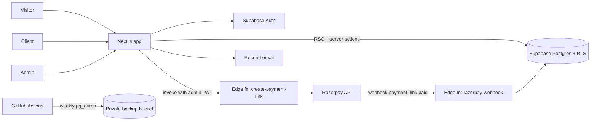
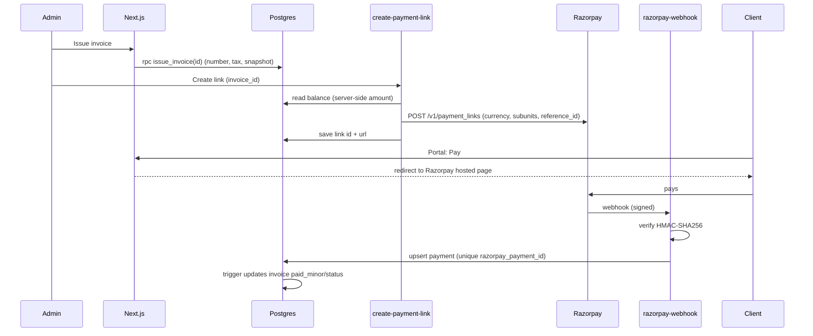
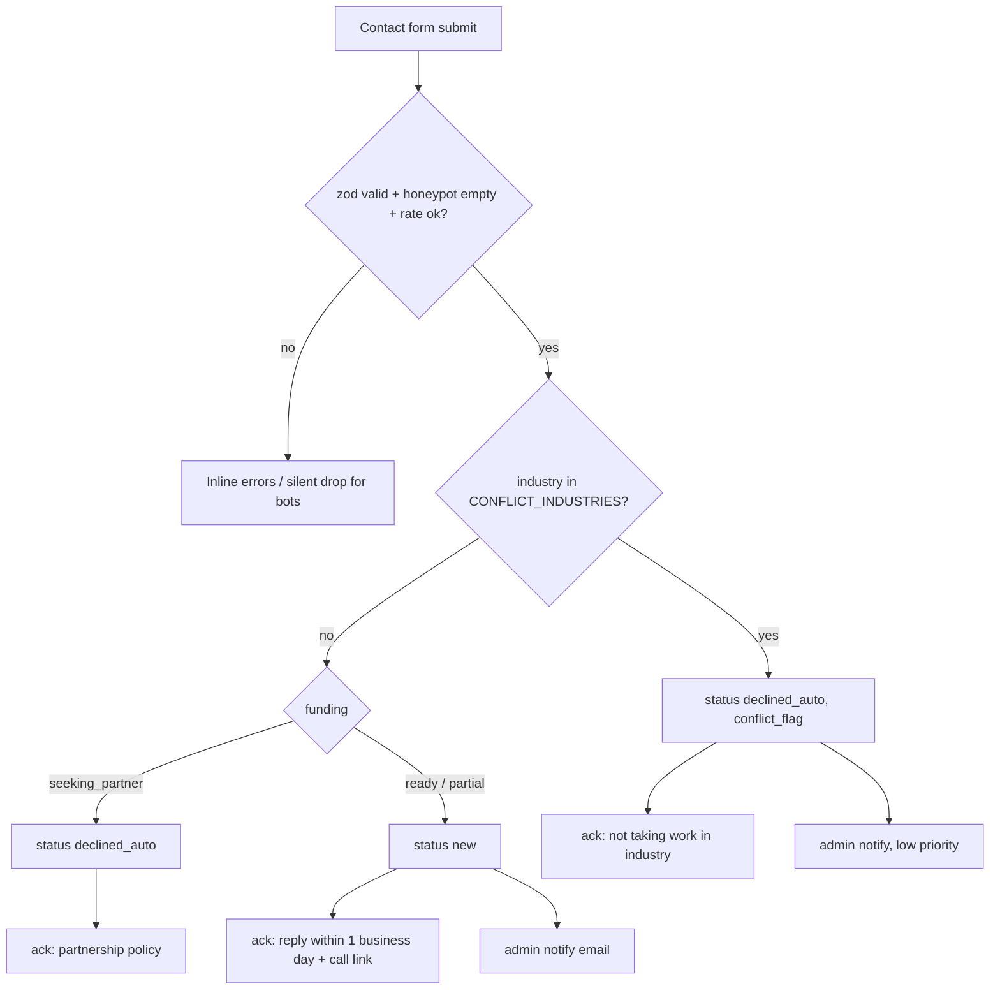
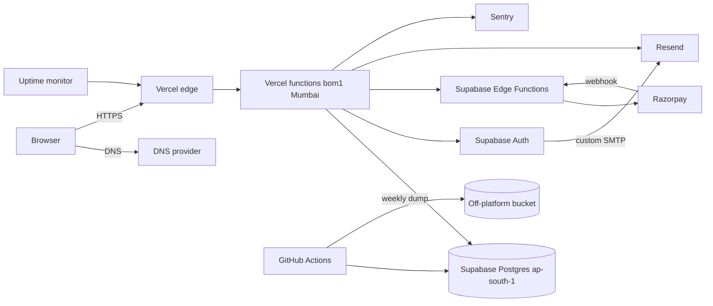

# Appamania — PRD, Design System and Technical Architecture

| | |
|---|---|
| Document | Single source of truth: product, UI design system, application architecture, infrastructure |
| Version | 3.0 (supersedes v2 `appamania-prd-design-system.md`, v1 `appamania-platform-tdd.md`, `appamania-tokens.css`) |
| Owner | Sumit Pal |
| Status | Approved for build |
| Date | 26 Sep 2026 |
| Tenancy | Single-tenant (one admin) |
| Domain | appamania.in (primary). appamania.com: optional 301 redirect if obtainable at normal price |

**How to read this document**
- Part I (Product): what we build and why. Read before scoping any change.
- Part II (Design system): every visual and interaction decision. UI code must use these tokens and components only.
- Part III (Application architecture): data, security, payments, finance.
- Part IV (Infrastructure): environments, DNS, email, CI/CD, backups, monitoring, cost, runbooks.
- Part V (Delivery): roadmap, risks, decisions.

**Conventions:** money is always integer minor units in code and DB. "Admin" means Sumit. "Client" means an invited user belonging to a client company. MUST/SHOULD/MAY follow RFC 2119 meaning.

---

# Part I — Product (PRD)

## 1. Summary

Appamania is a one-person mobile product studio. The platform has four jobs:

1. **Show:** a playable, interactive portfolio where visitors try real Flutter work in the browser instead of reading about it.
2. **Sell:** honest, founding-client pricing with self-serve checkout for small fixed packages and a qualified enquiry path for larger ones.
3. **Deliver:** an invite-only client portal with projects, milestones, tasks (including client action items), deadlines, progress, updates, invoices and autopay.
4. **Run the business:** admin console for client and project lifecycle, GST-correct invoicing, every payment type through Razorpay, and FY exports for ITR and GST.

Positioning: **Mobile product studio. Validate fast, build right. Honest pricing.**

Philosophy in one line: *pay for the work, own your accounts, stop at any gate* (§4.1).

## 2. Problem and evidence

| Problem | Evidence | Platform response |
|---|---|---|
| Current site reads as hobby/community studio; weak for paying clients | Donation section beside "Hire Me", no services, no case studies, no process | Portfolio-first landing, packages, case studies, process, published terms |
| Serious inbound is attracted by the shipped-products portfolio | Sep 2026 inbound partnership lead cited live apps, package and game in validation as the reason for contact | Keep and elevate studio products (`/studio`) as proof, with shipped status and metrics |
| Unqualified leads waste hours | Same lead: 10-message thread, full delivery plan and time slots sent before learning the lead wanted a funding partner, not paid development | Funding status is the first form question; equity-only leads get an automatic policy reply and no call |
| Slow first response | First reply sent 10 days after inbound | Instant auto-acknowledgement; 1-business-day reply standard; admin inbox shows lead age |
| Pricing felt out of reach for early-stage founders; no way to buy small work quickly | Every engagement required a call and proposal | Founding-client pricing, self-serve checkout for Audit / Spike / Landing |
| Portfolio only *described* work | Static screenshots and text | Playable Flutter demos, estimate builder, gate ladder |
| Split identity | Leads write to a personal Gmail; site shows domain email | One address: `hello@appamania.in` |
| Status updates and invoices handled manually | Email threads, spreadsheets | Portal with progress and updates; invoicing and Razorpay payment links |
| Tax season scramble | No structured receipts record | Per-receipt INR value, FX, fees, TDS; one-click FY exports |

## 3. Personas

**P1 — Admin (Sumit).** Senior Flutter engineer running the studio alongside a full-time role. Time-poor; works evenings. Needs: fast lead triage, zero-effort status reporting, correct invoices, clean FY data. Uses desktop mostly, mobile for quick checks.

**P2 — Client stakeholder.** Funded founder, PM or agency lead. Non-technical to semi-technical. Needs: know what's done, what's next, when it ships, what they owe; pay without friction. Checks portal weekly, often on mobile.

**P3 — Prospect.** Three sub-types:
- P3a *Funded founder/team* — has budget, wants an MVP or production app. Target.
- P3b *Company with existing app* — needs audit, rescue, or retainer. Target.
- P3c *Idea-holder seeking funding or tech co-founder* — wants equity-only or unpaid development. Filter out politely and automatically.
- P3d *Budget buyer* — early founder or small business wanting a fixed, small outcome (audit, spike, landing page) now, without calls. Target for self-serve.

**P4 — Studio visitor/player.** Discovers Appamania via own apps, games, packages. May become P3a. Needs: see what's shipped, try it, understand who built it.

## 4. Business model and pricing

### 4.1 Philosophy
1. **Honest pricing.** Prices cover Appamania's own tooling plus a minimal labour floor. Client-side infrastructure is billed at cost or paid directly by the client. No markup, ever.
2. **Client owns the accounts.** Apple Developer, Google Play, Supabase, Firebase, Vercel, domain and AI API accounts for a client's product are created in the client's name, on the client's card. Appamania is added as a member. IP, store ownership and billing stay clean.
3. **Pay per gate.** Spike → Validate → Launch → Care. Each gate is a paid decision; the client can stop at any gate and keeps everything delivered so far.
4. **Proof over promise.** Studio products and a playable portfolio do the selling.
5. **Boxed scope.** Low prices only work with fixed scope. Anything outside scope is a change request.
6. **Founding-client pricing.** Current prices are for the first 5 clients, in exchange for a case study and testimonial. Pricing is reviewed once all founding slots are filled.

### 4.2 Lanes
1. **Client studio** (revenue): fixed-price packages, some purchasable self-serve.
2. **Studio products** (proof and inbound): own apps, games, packages. Dusk sub-brand.
3. **Partnerships** (gated): hybrid only after a paid Validate meets agreed metrics. No equity-only or unpaid builds.

### 4.3 Packages (founding-client pricing)

| ID | Package | Scope | Duration | INR | USD | Purchase |
|---|---|---|---|---|---|---|
| `audit` | Audit | Flutter app architecture and performance review, prioritized fix plan | 1 week | ₹7,999 | $99 | Self-serve |
| `spike` | Spike | Prototype of the riskiest feature, cost/latency report, go/no-go, fixed quote for next gate. Credited to Validate if started within 30 days | 1 week | ₹9,999 | $149 | Self-serve |
| `landing` | Landing | One-page Next.js site, up to 6 sections, contact form, SEO basics, deployed to client's Vercel | 1–2 weeks | ₹14,999 | $199 | Self-serve |
| `validate` | Validate | MVP around one core loop, store-ready builds, analytics funnel, weekly test builds | 4–6 weeks | ₹49,999 | $699 | Enquiry → proposal |
| `launch` | Launch | Production v1: architecture, backend, CI/CD, crash reporting, store release | 8–12 weeks | ₹1,49,999 | $1,999 | Enquiry → proposal |
| `care` | Care | 20 hours/month: updates, OS/SDK bumps, fixes; no rollover | Monthly | ₹9,999/mo | $149/mo | Subscription (autopay) |
| `change` | Change request | Out-of-scope work | Hourly | ₹999/hr | $19/hr | Invoice |
| `partner` | Studio partner | Min 50% of Launch price in cash + revenue share or equity | Per deal | Hybrid | Hybrid | Term sheet |

**Pricing rules**
- Every price ends in 9 in its major unit (CI test on `config/packages.ts`).
- USD is not a straight conversion; it absorbs the international card fee (~3%) and FX spread.
- INR prices are shown with "+ GST if applicable". Until GST registration, no GST is charged; after registration, prices stay the same and GST is added.
- Care at ₹9,999 stays under the ₹15,000 UPI Autopay limit, so monthly debits need no extra authorisation.
- Founding slots remaining is shown on `/services` from `config/site.ts`.

### 4.4 Client infrastructure (at cost, client-owned)
Shown on `/services` as "What you pay for", and computed live in the estimate builder (§19.15).

| Item | Cost | When needed |
|---|---|---|
| Apple Developer Program | $99/year | iOS apps |
| Google Play Console | $25 one-time | Android apps |
| Supabase | Free tier for MVPs (pauses after 7 idle days); Pro $25/month for production | Backend |
| Firebase | Spark free / Blaze pay-as-you-go (≈ $0 at MVP scale) | Push, analytics, crash reporting |
| Vercel | Hobby for non-commercial; Pro ~$20/month for commercial web | Web / landing |
| Domain | ~₹800–1,500/year | Web |
| AI APIs | Usage-based; estimated in Spike report | AI features |

Appamania's own tooling (Claude Pro, a share of portal hosting) is ≈ $30–40/month and is already inside package prices.

### 4.5 Published engagement terms
1. Fixed price per package against a written scope.
2. Self-serve packages (Audit, Spike, Landing) are paid in full at checkout; work starts within 3 business days.
3. Validate and Launch: kickoff payment 40% on signing; remaining milestones invoiced on delivery and paid before the next begins.
4. Care is billed monthly by autopay (UPI Autopay, card or eMandate); cancel anytime before the next cycle.
5. Weekly test build and written update in the portal.
6. Source code and IP transfer on final payment.
7. Client creates and owns all third-party accounts; Appamania is invited as a member.
8. Refunds: self-serve packages refundable in full before work starts; after start, pro-rata for undelivered milestones.
9. No equity-only or unpaid builds.

### 4.6 Employment-conflict guardrail
Moonlighting is permitted by the employer unless the work is in the same domain or industry.
- Industry is required on every enquiry and every self-serve checkout. `CONFLICT_INDUSTRIES` matches **block checkout before payment** and auto-decline enquiries (admin override is audit-logged).
- Employer work appears on the site only generically.
- **Launch blocker:** written HR clarification that "domain" means business domain, not "mobile development".

## 5. Goals, non-goals, metrics

### 5.1 Goals
- G1 Convert qualified prospects into paid Spike or Validate engagements.
- G2 Remove unqualified leads before any manual effort.
- G3 Zero manual status reporting: portal is the status report.
- G4 Invoices issued, paid and reconciled inside the platform.
- G5 FY exports usable by CA without rework.
- G6 Zero cross-client data exposure.

### 5.2 Non-goals (v1)
Multi-tenant resale; in-portal checkout modal; subscriptions; client write access (comments, uploads); chat; time tracking; native mobile admin app (planned later).

### 5.3 Success metrics

| Metric | Target (first 6 months) | Source |
|---|---|---|
| Qualified leads (funding = ready/partial, no conflict) share | ≥ 60% of submissions | `leads` |
| Median time to first human reply | < 1 business day | `leads.first_reply_at` |
| Lead → discovery call | ≥ 40% of qualified | `leads.status` |
| Discovery call → paid package | ≥ 25% | `leads.status = won` |
| Days sales outstanding (issue → paid) | < 10 days | `invoices`, `payments` |
| Clients active in portal weekly (during active projects) | ≥ 70% | Supabase auth logs |
| RLS isolation incidents | 0 | Tests + audit |
| Landing Lighthouse (mobile) | Performance ≥ 90, Accessibility 100 | CI |
| FY export rework requested by CA | None | Manual |
| `/start` visit → paid self-serve | ≥ 3% | Analytics + `leads.status` |
| Demo plays per landing visit | ≥ 15% | Analytics |
| Founding slots filled | 5 within 6 months | `config/site.ts` |
| Care churn | < 1 cancellation per quarter | `subscriptions` |

## 6. Scope: epics, stories, acceptance criteria

Priority: **M** must (launch), **S** should (within 4 weeks of launch), **C** could.

### E1 Marketing site
| # | Story | P | Acceptance criteria |
|---|---|---|---|
| E1.1 | As a prospect I see who Appamania helps and what it ships within 5 seconds | M | Hero shows outcome headline, subhead, availability, 3 proof chips, two CTAs; LCP < 2.0s on 4G |
| E1.2 | As a prospect I read case studies with problem, role, stack, result | M | ≥ 3 published MDX case studies; each has a measurable result line |
| E1.3 | As a prospect I compare packages and prices | M | `/services` lists all packages with exact founding prices (INR/USD toggle), "What you pay for" infra table, terms, refund policy, partnership policy, founding slots left |
| E1.4 | As a visitor I explore studio products | M | `/studio` lists apps, games, packages with status (Live, In validation, Archived), links, metrics; rendered in Dusk sub-brand |
| E1.5 | As a visitor I read about Sumit | M | `/about` with story, condensed timeline, stack |
| E1.6 | As a visitor I can find legal pages | M | Privacy, terms, refunds/cancellation, contact pages live (also required for Razorpay) |
| E1.7 | As a client I find login | M | "Client login" in header (desktop) and footer |
| E1.8 | Old URLs keep working | M | `/apps` → `/studio`; `/apps/*` → `/studio/*`; `/oss/*` → `/studio/*` 301 |
| E1.9 | As a supporter I can buy a chai | C | See E14 |

### E2 Lead intake and qualification
| # | Story | P | Acceptance criteria |
|---|---|---|---|
| E2.1 | As a prospect I submit a project enquiry | M | Fields: name, email, company, industry, funding status, package interest, budget band, timeline, summary. Honeypot + rate limit (5/hour/IP). Inline validation |
| E2.2 | As a prospect I get an immediate acknowledgement | M | Email within 1 minute; content varies by funding status (§26.3) |
| E2.3 | As admin, equity-only leads are filtered | M | `funding_status = seeking_partner` → status `declined_auto`, policy email sent, no call link |
| E2.4 | As admin, employer-industry leads are flagged | M | `conflict_flag = true`, status `declined_auto` unless admin overrides with reason (audit-logged) |
| E2.5 | As admin I triage leads by age | M | `/admin/leads` sorted by age; badge turns warning at 24h, danger at 48h without reply |
| E2.6 | As admin I convert a lead into a client | S | "Convert" pre-fills onboarding form from lead |

### E3 Authentication
| # | Story | P | Acceptance criteria |
|---|---|---|---|
| E3.1 | Nobody can self-register | M | Public signup disabled; `/login` has no signup link |
| E3.2 | As an invited client I set up access from email | M | Invite link → set password → `/portal` |
| E3.3 | As admin I sign in with MFA | M | TOTP required; admin routes require `aal2` |
| E3.4 | As a user I reset my password | M | Standard reset flow via email |

### E4 Client lifecycle
| # | Story | P | Acceptance criteria |
|---|---|---|---|
| E4.1 | As admin I onboard a client company and its first user | M | Creates `clients`, auth invite, `profiles`, `client_members`; audit entry |
| E4.2 | As admin I add another user to a client | S | Invite + membership |
| E4.3 | As admin I offboard a client | M | Typed-name confirmation; status offboarded; users banned; projects archived; unpaid invoices remain; access revoked immediately (RLS) |
| E4.4 | As admin I reactivate a client | S | Reverse of E4.3 |

### E5 Projects and delivery
| # | Story | P | Acceptance criteria |
|---|---|---|---|
| E5.1 | As admin I create a project from a package | M | Fields: client, name, package, billing, currency, budget, start, deadline; milestones pre-filled from package template |
| E5.2 | As admin I manage milestones and tasks | M | CRUD; status; due dates; client-visible toggle; sort |
| E5.3 | As admin I post an update | M | Markdown text, client-visible toggle; appears in portal feed |
| E5.4 | As admin I see project health | M | Overdue task count, next deadline, progress |
| E5.5 | As admin I archive a project | M | Status archived; hidden from client dashboard default view; history retained |

### E6 Client portal
| # | Story | P | Acceptance criteria |
|---|---|---|---|
| E6.1 | As a client I see my projects at a glance | M | Cards: name, status, progress %, next milestone and date, overdue badge |
| E6.2 | As a client I see project detail | M | Milestone timeline, tasks grouped by status (visible only), updates feed |
| E6.3 | As a client I see and pay invoices | M | Invoices list with status and balance; "Pay" opens Razorpay link; printable invoice |
| E6.4 | As a client I never see another client's data | M | pgTAP and E2E isolation tests pass in CI |

### E7 Invoicing
| # | Story | P | Acceptance criteria |
|---|---|---|---|
| E7.1 | As admin I draft an invoice with line items | M | Items with SAC, qty, unit price; supply type; TDS expected |
| E7.2 | As admin I issue it | M | Gapless FY number; tax split computed in DB; client snapshot frozen; issued invoice immutable |
| E7.3 | As admin I void and reissue | M | Void keeps number; reissue gets next number |
| E7.4 | Anyone authorised can print it | M | `/invoice/[id]/print` A4 layout; browser saves PDF |

### E8 Payments
| # | Story | P | Acceptance criteria |
|---|---|---|---|
| E8.1 | As admin I create a Razorpay payment link | M | Amount = balance from DB in invoice currency; idempotent by invoice number |
| E8.2 | Payments reconcile automatically | M | Signed webhook records payment once; invoice status updates |
| E8.3 | As admin I record a manual payment | M | Bank transfer / UPI / other with reference and INR value |
| E8.4 | As admin I sync a payment by ID | S | Fetch from Razorpay API and upsert |

### E9 Finance
| # | Story | P | Acceptance criteria |
|---|---|---|---|
| E9.1 | As admin I see FY summary | M | Receipts (INR), GST collected by type, exports under LUT, TDS, gateway fees, expenses |
| E9.2 | As admin I export for CA | M | Three CSVs per FY (§36) |
| E9.3 | As admin I log expenses | S | Date, category, vendor, amount, GST input, receipt upload (C) |

### E10 Studio content
| # | Story | P | Acceptance criteria |
|---|---|---|---|
| E10.1 | Studio products managed as content | M | MDX per product with frontmatter (status, platforms, links, metrics) |
| E10.2 | Package pages link to relevant studio proof | C | "Built with this approach" links |

### E11 Self-serve checkout
| # | Story | P | Acceptance criteria |
|---|---|---|---|
| E11.1 | As a buyer I purchase Audit, Spike or Landing without a call | M | `/start` collects details (name, email, phone, company, industry, country, state, GSTIN optional, brief), shows price in INR or USD, creates Razorpay payment link, redirects |
| E11.2 | Conflicting industries cannot pay | M | Industry match blocks checkout with a polite message before a link is created |
| E11.3 | After payment I'm onboarded automatically | M | Webhook creates client, invite, project from package template, issued invoice, payment; buyer lands on `/start/success` and receives invite + receipt emails |
| E11.4 | As admin I see self-serve purchases | M | Admin dashboard highlights new self-serve projects; "work starts within 3 business days" timer |
| E11.5 | As admin I refund a self-serve purchase | S | Refund issued in Razorpay; `refund.processed` webhook records refund and updates invoice balance |

### E12 Subscriptions (Care)
| # | Story | P | Acceptance criteria |
|---|---|---|---|
| E12.1 | As admin I start Care for a client | M | Creates Razorpay subscription on the Care plan in client currency; link shown in portal and emailed |
| E12.2 | As a client I set up autopay once | M | Authorise via UPI Autopay / card / eMandate on Razorpay hosted page |
| E12.3 | Each monthly charge is invoiced | M | `subscription.charged` creates issued invoice + payment automatically |
| E12.4 | Failed/halted/cancelled states are visible | M | Portal and admin show subscription status; admin notified on `pending`/`halted` |
| E12.5 | As a client I cancel | S | Cancel request from portal → admin cancels at cycle end |

### E13 Interactive portfolio
| # | Story | P | Acceptance criteria |
|---|---|---|---|
| E13.1 | As a visitor I play a real Flutter demo | M | Hero device frame shows poster; "Play demo" loads a Flutter web build in a sandboxed iframe from `demos.appamania.in`; nothing loads before interaction |
| E13.2 | As a visitor I estimate my project | M | Estimate builder: work type, platforms, backend, AI → package, price, timeline, client infra cost; CTA buy (self-serve) or enquire |
| E13.3 | As a visitor I explore the gate ladder | M | Interactive Spike → Validate → Launch → Care stepper with deliverables and prices |
| E13.4 | As a keyboard user I jump anywhere | S | ⌘K / Ctrl+K command palette: pages, case studies, studio apps, copy email, start project |
| E13.5 | As a visitor I see what's shipping now | S | "Now shipping" log from latest MDX entries (date, product, one-line change) |

### E14 Support payments
| # | Story | P | Acceptance criteria |
|---|---|---|---|
| E14.1 | As a supporter I buy a chai | C | ₹99 / ₹199 / ₹499 or $4.99 / $9.99 via Razorpay payment link; recorded as `support` payment, no invoice |

## 7. Non-functional requirements

| Area | Requirement |
|---|---|
| Performance | Landing: LCP < 2.0s (4G), CLS < 0.1, INP < 200ms, landing JS < 120KB gz. Portal: TTFB < 500ms (India), page interactive < 2.5s |
| Availability | Target 99.5% monthly (hosting SLAs); payments path degrades to manual bank transfer |
| Security | OWASP ASVS L1 baseline; RLS on every table; MFA for admin; secrets never in client bundle |
| Privacy | Minimal PII (name, email, phone, company, GSTIN, address); no third-party trackers beyond first-party analytics; data residency India (Supabase Mumbai) |
| Accessibility | WCAG 2.2 AA |
| Browser support | Last 2 versions of Chrome, Safari, Firefox, Edge; iOS Safari 16+ |
| Responsiveness | 360px to 1920px; portal usable one-handed on mobile |
| Data retention | Finance records never hard-deleted; leads purged after 24 months unless converted |
| Maintainability | Solo-maintainable: one repo, one language (TypeScript + SQL), no bespoke infra |
| Cost | < $80/month infrastructure at launch scale (incl. Claude Pro) |
| Interactive weight | Flutter demos and estimate builder add 0 KB to initial landing load; demos load only on interaction from a separate origin |

## 8. Constraints and assumptions

| # | Item | Impact |
|---|---|---|
| A1 | Moonlighting allowed except same domain/industry | §4.6 guardrail |
| A2 | Razorpay registered-business KYC with international enabled | Else international via SWIFT/PayPal (manual entry) |
| A3 | Foreign clients pay by card via Razorpay (no foreign wire/netbanking) | ~3% fee; SWIFT option for large invoices |
| A4 | App issues GST invoices; Razorpay API issues non-GST invoices only | Own invoicing module |
| A5 | GST registration timing decided with CA | `non_gst` supply supported until registered |
| A6 | Single admin | Roles: admin, client |
| A7 | pub.dev verified publisher is bound to appamania.in | DNS verification record MUST be preserved forever |
| A8 | Razorpay handles every web/service payment | One-off via Payment Links, recurring via Subscriptions, refunds via Refunds |
| A9 | UPI Autopay auto-debits above ₹15,000 need extra authorisation | Care priced at ₹9,999 |
| A10 | International recurring card payments are an on-demand Razorpay feature | Request before first international Care client |
| A11 | Digital goods inside iOS/Android apps must use store billing | Razorpay not used inside studio apps |
| A12 | Client owns third-party accounts | Onboarding includes client action items |

---

# Part II — Design system

## 9. Principles

1. **Proof over promise.** Every screen leads with evidence: shipped status, numbers, dates. Decoration never outranks content.
2. **Quiet by default, loud on purpose.** One primary action per view. Color carries meaning (brand, status), never sequence or decoration.
3. **Same system, two densities.** Marketing is spacious and editorial; portal/admin is compact and scannable. Tokens are shared; spacing and type steps differ.
4. **Tokens or nothing.** No raw hex, px font sizes or ad-hoc shadows in components. CI rejects raw hex outside `styles/tokens.css`.
5. **Native first.** Native `<input type="date">`, `<dialog>`, `<details>`, CSS animations before any library.
6. **Accessible is the baseline, not a feature.** WCAG 2.2 AA, keyboard complete, reduced motion respected.
7. **Play, don't tell.** Where a claim can be demonstrated (a Flutter demo, a live estimate, a real price), demonstrate it.
8. **Interaction costs nothing until used.** Heavy interactive pieces load on intent, never on page load.

## 10. Token architecture

Three layers. Components read only layer 3 (or layer 2 when no component token exists).

```
Layer 1  Primitive   --green-600: #1A7F4B            raw values, never used in components
Layer 2  Semantic    --primary: var(--green-600)       purpose; flips per theme and brand
Layer 3  Component   --btn-primary-bg: var(--primary)   per component, optional
```

**Naming:** kebab-case; `--{category}-{name}-{variant}-{state}`. Examples: `--fg-muted`, `--btn-primary-bg-hover`, `--status-danger-bg`.

**Theming axes**
- **Mode:** light/dark via `color-scheme` + `light-dark()`. Follows OS; `data-theme="light|dark"` on `<html>` overrides (persisted in `localStorage`, applied by a 3-line inline script before paint).
- **Brand:** `data-brand="green"` (default, master brand) or `data-brand="dusk"` (studio sub-brand). Scoped per element, so a Dusk section can live inside a green page.
- **Density:** `data-density="comfortable"` (marketing, default) or `"compact"` (portal/admin root layouts).

## 11. Color primitives

### 11.1 Green (master brand)
| Stop | Hex | Typical use |
|---|---|---|
| green-50 | `#EEF8F1` | Tint backgrounds (light) |
| green-100 | `#D5EFDD` | Selected row (light) |
| green-200 | `#AEDFBF` | Borders on tint |
| green-300 | `#7CCB9C` | Dark-mode hover |
| green-400 | `#2FB36A` | Primary (dark mode) |
| green-500 | `#22995A` | Charts |
| green-600 | `#1A7F4B` | Primary (light mode), 5.0:1 with white |
| green-700 | `#15693E` | Primary hover (light) |
| green-800 | `#115332` | Text on green tint |
| green-900 | `#0D3F27` | Tint backgrounds (dark) |
| green-950 | `#072417` | Deepest brand surface |

### 11.2 Lime (accent spark)
| Stop | Hex |
|---|---|
| lime-100 | `#F3FCD9` |
| lime-200 | `#E4F7B8` |
| lime-400 | `#C6F24E` |
| lime-600 | `#7FA51C` |
| lime-800 | `#2F4A06` |

### 11.3 Neutral (green-tinted gray)
| Stop | Hex | Stop | Hex |
|---|---|---|---|
| neutral-0 | `#FFFFFF` | neutral-600 | `#4B5B52` |
| neutral-25 | `#F5F9F6` | neutral-700 | `#34423A` |
| neutral-50 | `#EDF2EE` | neutral-800 | `#24372C` |
| neutral-100 | `#DCE6DF` | neutral-850 | `#1A2A21` |
| neutral-200 | `#C3D0C7` | neutral-900 | `#13211A` |
| neutral-300 | `#9DB3A6` | neutral-950 | `#0B1410` |
| neutral-400 | `#7A8E82` | neutral-1000 | `#060C09` |
| neutral-500 | `#5E7066` | ink | `#0E1A14` |

### 11.4 Dusk (studio sub-brand; source palette `#432C51 #535474 #54A4AF #ECBC55`)
| Ramp | Stops |
|---|---|
| plum | 50 `#F5F0F7` · 100 `#E7E1EA` · 200 `#CDBFD6` · 300 `#A58CB3` · 400 `#7A5C8C` · 500 `#5E4470` · 600 `#533A63` · **700 `#432C51`** · 800 `#2A1D34` · 900 `#1C1223` · 950 `#120B17` |
| slate | 200 `#D6D5E3` · 300 `#B9B4CC` · **600 `#535474`** · 800 `#34354C` |
| teal | 200 `#BFE0E4` · 300 `#8CC6CD` · **400 `#54A4AF`** · 600 `#2E7A84` · 800 `#1D4E55` |
| mustard | 100 `#FBF1D9` · 200 `#F7E3B3` · **400 `#ECBC55`** · 700 `#9A6F12` · 900 `#4D370A` |
| cream | `#FBF8F3` |

### 11.5 Status (shared by both brands)
| Ramp | Light fg | Light bg | Dark fg | Dark bg |
|---|---|---|---|---|
| success | `#15803D` | `#E8F6EC` | `#4ADE80` | `#0F2A1A` |
| warning | `#A16207` | `#FDF4DC` | `#FACC15` | `#2E2408` |
| danger | `#B91C1C` | `#FDECEC` | `#F87171` | `#2F1111` |
| info | `#1D4ED8` | `#E8EFFD` | `#60A5FA` | `#0F1D36` |

Success sits close to brand green. Rule: status is never conveyed by color alone — always icon + label.

## 12. Semantic color tokens

### 12.1 Green brand (default)
| Token | Light | Dark | Use |
|---|---|---|---|
| `--bg` | neutral-25 | neutral-950 | Page canvas |
| `--surface` | neutral-0 | neutral-900 | Cards, inputs, panels |
| `--surface-sunken` | neutral-50 | neutral-1000 | Wells, table headers, code |
| `--surface-raised` | neutral-0 | neutral-850 | Dialogs, menus |
| `--fg` | ink | neutral-50 | Body text |
| `--fg-muted` | neutral-600 | neutral-300 | Secondary text |
| `--fg-subtle` | neutral-500 | neutral-400 | Placeholders, metadata (≥ 4.5:1 on `--surface`) |
| `--border` | neutral-100 | neutral-800 | Default hairline |
| `--border-strong` | neutral-200 | neutral-700 | Hover, dividers |
| `--primary` | green-600 | green-400 | Primary actions, links |
| `--primary-hover` | green-700 | green-300 | |
| `--primary-fg` | neutral-0 | neutral-950 | Text on primary |
| `--primary-tint` | green-50 | green-900 | Selected, subtle highlight |
| `--primary-tint-fg` | green-800 | green-100 | Text on tint |
| `--accent` | lime-200 | lime-400 | Availability badge, highlight marks |
| `--accent-fg` | lime-800 | neutral-950 | Text on accent |
| `--link` | green-600 | green-400 | Inline links (underlined) |
| `--ring` | green-600 | lime-400 | Focus ring |
| `--overlay` | ink / 50% | black / 60% | Dialog backdrop |
| `--status-{success,warning,danger,info}` | §11.5 light fg | §11.5 dark fg | Status text/icon |
| `--status-{…}-bg` | §11.5 light bg | §11.5 dark bg | Status pill/banner background |

### 12.2 Dusk brand (`data-brand="dusk"`)
| Token | Light | Dark |
|---|---|---|
| `--bg` | cream | plum-900 |
| `--surface` | `#FFFFFF` | plum-800 |
| `--surface-sunken` | plum-50 | plum-950 |
| `--surface-raised` | `#FFFFFF` | plum-700 |
| `--fg` | `#2A1B33` | `#F3EEF6` |
| `--fg-muted` | slate-600 | slate-300 |
| `--border` | plum-100 | plum-700 |
| `--border-strong` | plum-200 | plum-600 |
| `--primary` | plum-700 | teal-400 |
| `--primary-hover` | plum-600 | teal-300 |
| `--primary-fg` | `#FFFFFF` | plum-900 |
| `--primary-tint` | plum-50 | plum-700 |
| `--primary-tint-fg` | plum-700 | plum-100 |
| `--accent` | mustard-400 | mustard-400 |
| `--accent-fg` | plum-700 | plum-900 |
| `--link` | teal-600 | teal-400 |
| `--ring` | teal-600 | mustard-400 |

Contrast notes: raw teal-400 fails 4.5:1 on light surfaces, so light-mode links use teal-600. Mustard is fill-only, never text on light.

### 12.3 Chart palette
Categorical, max 5 series: green-500, teal-600, mustard-700, plum-400, neutral-400. Money-in series always green-500; money-out (fees, expenses) always neutral-400.

## 13. Typography

### 13.1 Families
| Role | Family | Weights | Loading |
|---|---|---|---|
| Display | Archivo | 600, 700 | `next/font/google`, subset latin, `display: swap` |
| Body/UI | Space Grotesk | 400, 500 | same |
| Mono | JetBrains Mono | 400 | same, only on pages that use it |

Fallbacks: `system-ui, -apple-system, "Segoe UI", sans-serif`; mono `ui-monospace, Menlo, monospace`. Numbers in tables and money: `font-variant-numeric: tabular-nums`.

### 13.2 Fluid scale (marketing, 360–1440px)
| Token | Min → max | Line height | Use |
|---|---|---|---|
| `--step--1` | 0.83 → 0.94rem | 1.5 | Captions, meta |
| `--step-0` | 1.00 → 1.13rem | 1.6 | Body |
| `--step-1` | 1.25 → 1.56rem | 1.4 | Lead paragraph, H4 |
| `--step-2` | 1.56 → 2.16rem | 1.25 | H3 |
| `--step-3` | 1.95 → 3.00rem | 1.15 | H2 |
| `--step-4` | 2.44 → 4.20rem | 1.05 | H1 / hero |

### 13.3 Fixed scale (portal/admin, compact density)
| Token | Size | Line height | Weight | Use |
|---|---|---|---|---|
| `--text-xs` | 12px | 16px | 500 | Badges, table meta |
| `--text-sm` | 14px | 20px | 400 | Table cells, inputs, secondary |
| `--text-base` | 15px | 22px | 400 | Default portal text |
| `--text-lg` | 18px | 26px | 500 | Card titles |
| `--text-xl` | 22px | 28px | 600 display | Page titles |
| `--text-2xl` | 28px | 34px | 600 display | Dashboard numbers |

### 13.4 Rules
- Headings: Archivo, letter-spacing −0.02em at step-3+; sentence case.
- Body line length 60–75ch (`max-width: 68ch` on prose).
- Two body weights only (400, 500). Bold inside sentences not allowed; use structure instead.
- Mono only for code, IDs, invoice numbers and stats labels.

## 14. Spacing, layout, grid

### 14.1 Spacing scale (4px base)
`--space-0` 0 · `--space-1` 4px · `--space-2` 8px · `--space-3` 12px · `--space-4` 16px · `--space-5` 20px · `--space-6` 24px · `--space-8` 32px · `--space-10` 40px · `--space-12` 48px · `--space-16` 64px · `--space-24` 96px

Fluid section rhythm (marketing): `--section-y: clamp(3rem, 2.2rem + 3.6vw, 6rem)`; `--gutter: clamp(1rem, 0.6rem + 1.8vw, 2rem)`.

### 14.2 Breakpoints
| Name | Min width | Notes |
|---|---|---|
| base | 0 | Designed first at 360px |
| sm | 640px | |
| md | 768px | Portal sidebar appears |
| lg | 1024px | Marketing 12-col grid |
| xl | 1280px | Max content width reached |

### 14.3 Containers
- Marketing: `max-width: 1200px`, 12-column grid, gap `--gutter`. Prose `68ch`.
- Portal/admin: sidebar 240px (collapses to top bar + drawer below md), content `max-width: 1280px`, padding `--space-6` (md+) / `--space-4` (base).
- Print invoice: A4, 16mm margins.

### 14.4 Density
| Property | Comfortable | Compact |
|---|---|---|
| Control height | 44px | 36px |
| Table row | 52px | 40px |
| Card padding | 24px | 16px |
| Stack gap | 24px | 12px |

Touch targets stay ≥ 44×44px on touch devices regardless of density (`@media (pointer: coarse)`).

## 15. Shape, borders, elevation, layering

| Token | Value | Use |
|---|---|---|
| `--radius-sm` | 6px | Badges, checkboxes |
| `--radius` | 10px | Buttons, inputs |
| `--radius-lg` | 16px | Cards, dialogs |
| `--radius-full` | 999px | Avatars, pills |
| `--border-width` | 1px | All borders |
| `--shadow-1` | `0 1px 2px rgb(0 0 0 / .06)` | Raised card hover |
| `--shadow-2` | `0 8px 24px rgb(0 0 0 / .12), 0 2px 6px rgb(0 0 0 / .08)` | Menus, dialogs |

Dark mode: shadows are ineffective; elevation is expressed by lighter surface (`--surface-raised`) plus border.

Z-index scale: base 0 · sticky 10 · header 20 · dropdown 30 · overlay 40 · dialog 50 · toast 60.

## 16. Motion

| Token | Value | Use |
|---|---|---|
| `--dur-fast` | 120ms | Hover, press |
| `--dur-base` | 200ms | Toggles, menus |
| `--dur-slow` | 320ms | Dialogs, section reveals |
| `--ease-out` | `cubic-bezier(.2,.8,.2,1)` | Entrances |
| `--ease-in-out` | `cubic-bezier(.4,0,.2,1)` | State changes |

Rules:
- Only `opacity` and `transform` are animated.
- Section reveal: 12px translate + fade, once, triggered by IntersectionObserver adding `.is-visible` (one shared 10-line helper).
- Progress bars animate width on first render only.
- `@media (prefers-reduced-motion: reduce)`: all durations → 0ms, no translate.
- No parallax, no scroll-jacking, no autoplay video. Marquee (if kept) pauses on hover/focus and under reduced motion.

**Motion intensity by surface**
| Surface | Intensity | Allowed |
|---|---|---|
| Landing, services, studio | Medium | Section reveals, scroll-driven progress (`animation-timeline: view()` as progressive enhancement), DevicePlayer float (±4px, 6s loop), GateLadder connector fill, hover lift on tiles (translateY −2px) |
| Case studies, about | Low | Reveals only |
| Portal, admin | Minimal | State transitions only (menus, dialogs, toasts) |

Page transitions: View Transitions API (cross-document `@view-transition { navigation: auto; }`) for marketing pages only, 200ms crossfade; browsers without support navigate normally.

## 17. Iconography, imagery, logo

**Icons:** Lucide, stroke 1.5, sizes 16 (inline/table), 20 (buttons), 24 (feature). Icons inherit `currentColor`. Decorative icons `aria-hidden="true"`; icon-only buttons need `aria-label`. No emoji as icons.

**Imagery:**
- App screenshots in a flat device frame (CSS border + radius, no photoreal mockups), WebP/AVIF, explicit width/height.
- Case study covers 16:9, 1600×900 source.
- No stock photos. Personal photo on `/about` only.

**Logo:**
- Monogram "A" in `--primary` with lime dot; wordmark `appamania` lowercase, Archivo 700, −0.03em.
- Clear space = height of the dot on all sides. Minimum size 24px monogram, 96px wordmark.
- On Dusk surfaces the monogram uses `--fg`, the dot mustard-400.
- Deliverables: SVG (mono, full color, reversed), favicon (SVG + 32px PNG), apple-touch-icon 180px, OG 1200×630.

## 18. Component tokens

```css
--btn-h: var(--control-h);             /* 44 comfortable, 36 compact */
--btn-px: var(--space-4);
--btn-radius: var(--radius);
--btn-primary-bg: var(--primary);
--btn-primary-bg-hover: var(--primary-hover);
--btn-primary-fg: var(--primary-fg);
--btn-secondary-bg: var(--surface);
--btn-secondary-border: var(--border-strong);
--btn-ghost-bg-hover: var(--surface-sunken);
--btn-danger-bg: var(--status-danger);
--input-bg: var(--surface);
--input-border: var(--border-strong);
--input-border-focus: var(--ring);
--card-bg: var(--surface);
--card-border: var(--border);
--card-radius: var(--radius-lg);
--card-pad: var(--card-padding);        /* 24 comfortable, 16 compact */
--table-head-bg: var(--surface-sunken);
--table-row-h: var(--row-h);
--table-row-hover: var(--surface-sunken);
--focus-ring: 0 0 0 2px var(--bg), 0 0 0 4px var(--ring);
```

## 19. Components

Each component lives in `components/ui/<Name>.tsx`, is a plain function component, uses Tailwind utilities mapped to tokens, and has no internal state library. Headless behavior uses native elements (`<dialog>`, `<details>`, `<select>`) first.

### 19.1 Button
| Variant | Use | Default | Hover | Active | Focus | Disabled |
|---|---|---|---|---|---|---|
| primary | One per view: main action | primary bg, primary-fg | primary-hover | scale .98 | focus-ring | Avoid; keep enabled and validate on submit |
| secondary | Other actions | surface bg, border-strong | surface-sunken | scale .98 | focus-ring | 50% opacity, `aria-disabled` |
| ghost | Toolbar, table row actions | transparent | surface-sunken | scale .98 | focus-ring | same |
| danger | Destructive confirm only (inside dialog) | status-danger bg, white | darker 8% | scale .98 | focus-ring | same |
| link | Inline action in text | link color, underline on hover | | | focus-ring | |

Sizes: `sm` 32px, `md` control-h, `lg` 52px (marketing hero only). Loading state: spinner replaces leading icon, label stays, `aria-busy="true"`, width locked. Icon + label gap 8px.

### 19.2 Form controls
- **Input / Textarea / Select:** label above (always visible), helper text below, error replaces helper in `--status-danger` with icon; `aria-invalid`, `aria-describedby`. Height = control-h. Border `--input-border`; focus → `--focus-ring`.
- **Date:** native `<input type="date">`.
- **Money input:** currency prefix adornment, `inputmode="decimal"`, tabular nums; stored as minor units.
- **Checkbox / Radio / Switch:** native inputs styled via `accent-color: var(--primary)`; switch = checkbox with `role="switch"`.
- **Required marker:** "(required)" text in label, not asterisk alone.
- **Validation timing:** on blur and on submit; clear on edit.

### 19.3 Badge / StatusPill
Height 22px, `--text-xs`, radius-full, padding 0 8px, leading 12px icon. Background `--status-*-bg`, text `--status-*`. Mapping in §20.

### 19.4 Card
Surface, border, radius-lg, padding card-pad. Variants: `default`, `interactive` (whole card is a link: hover border-strong + shadow-1, focus ring on card), `stat` (label `--text-sm` muted, value `--text-2xl` tabular, optional delta).

### 19.5 Table
- Header sticky, `--table-head-bg`, `--text-xs` uppercase not allowed (sentence case, 500 weight).
- Numeric columns right-aligned, tabular nums.
- Row hover `--table-row-hover`; clickable rows use a real link in the first cell (row click delegated), not `onclick` on `<tr>` only.
- Below md: tables with > 4 columns become stacked cards (same component, `data-layout="stack"`).
- Empty state inside table body (§19.11).

### 19.6 Progress
Track `--surface-sunken`, fill `--primary`, height 8px, radius-full, label "62%" right-aligned tabular; `role="progressbar"` with `aria-valuenow`. Overdue projects keep brand fill and show a separate danger badge (never red progress bars).

### 19.7 Milestone timeline
Vertical list; node 12px circle: done = primary filled with check, current = primary ring, upcoming = border-strong ring. Each row: title, due date, amount (admin only), status pill.

### 19.8 Dialog
Native `<dialog>` with `showModal()`. Max width 480px (confirm) / 640px (form). Backdrop `--overlay`. Focus first field; Esc closes; return focus to trigger. Destructive confirms require typing the entity name (offboard, void invoice).

### 19.9 Toast
Bottom-right (bottom-center on mobile), max 3 stacked, auto-dismiss 5s (errors persist until closed), `role="status"` (errors `role="alert"`). Copy: past tense, no "successfully".

### 19.10 Navigation
- **Marketing header:** logo, Work, Services, Studio, About, Contact; right: "Client login" (ghost), "Start a project" (primary). Sticky with `top: env(safe-area-inset-top)`, surface at 85% + backdrop blur disabled (flat), border-bottom on scroll. Mobile: menu button opens full-height `<dialog>`.
- **Portal/Admin sidebar:** logo, nav items (icon 20 + label), active item `--primary-tint` bg + `--primary-tint-fg`; account menu at bottom. Below md: top bar + drawer.
- **Breadcrumbs:** admin detail pages only.

### 19.11 Empty, loading, error states
- **Empty:** icon 24, headline naming the space, one-line body, single primary CTA. E.g. "No projects yet" / "Create a project to start tracking milestones." / "Create project".
- **Loading:** skeleton blocks matching final layout (Next.js `loading.tsx`), shimmer disabled under reduced motion. No spinners for page loads.
- **Error:** `error.tsx` per route group; says what happened and what to do; "Try again" button; error ID shown in mono for support.

### 19.12 Money display
`<Money minor={123450} currency="INR" />` → "₹1,234.50" via `Intl.NumberFormat('en-IN')` for INR, `'en-US'` otherwise; exponent from `Intl` resolved options. Always tabular nums. Negative values in parentheses in finance tables.

### 19.13 Avatar
Initials on `--primary-tint`, text `--primary-tint-fg`, sizes 24/32/40, radius-full.

### 19.14 Marketing blocks
Hero, ProofChips, CaseStudyCard, PackageCard (name, for, deliverables list, duration, from-price with INR/USD toggle, CTA), ProcessSteps (4 numbered steps, horizontal on lg, vertical below), TestimonialCard, TimelineCompact, CTASection, Footer. Studio blocks (Dusk): ProductCard (icon, name, status pill, platforms, one metric, links).

### 19.15 Interactive portfolio components

**DevicePlayer** (hero, case studies, studio pages)
- Anatomy: CSS device frame (radius 44px, 10px bezel `--fg` at 90%), poster image (WebP, first frame of the demo), overlay "Play demo" button (primary, with `play` icon), caption with app name and stack chips.
- States: `poster` → `loading` (skeleton shimmer inside frame, "Loading Flutter…" label) → `playing` (iframe) → `error` (poster + "Demo unavailable, watch video" link).
- Loading rule: iframe is created only after click/Enter. `src="https://demos.appamania.in/<slug>/"`, `sandbox="allow-scripts allow-same-origin"` (safe because the demo runs on a different origin), `loading="lazy"`, `title` set.
- Mobile (< md): "Play demo" opens the demo full-screen in a new tab instead of an iframe (better input, no scroll trap).
- Reduced motion: no frame tilt/float animation.

**EstimateBuilder** (`/start`, teaser on landing)
- Steps: 1 Work type (Audit, Spike, Landing, MVP, Production app, Care) → 2 Platforms (iOS, Android, Web) → 3 Backend (none, Supabase, Firebase) → 4 AI features (none, some) → 5 Summary.
- Summary card: recommended package, price (INR/USD toggle), timeline, "Your infra costs" list from §4.4 rules (e.g. iOS → Apple $99/year), total first-year infra estimate.
- CTA: self-serve packages → "Continue to checkout"; Validate/Launch → "Send enquiry" (prefills lead form).
- Pure client component, state in URL search params (shareable estimate), no server calls until CTA.
- Accessibility: each step is a `fieldset` with `legend`; radio cards are real radios; progress announced ("Step 2 of 5").

**GateLadder**
- Four connected nodes (Spike, Validate, Launch, Care); selected node expands a panel with deliverables, duration, price. Horizontal on lg, vertical accordion below. Built as `role="tablist"` with arrow-key navigation.

**CommandPalette**
- Trigger: ⌘K / Ctrl+K and a visible "Search" button in header. Native `<dialog>`, input + filtered list (`role="listbox"`), arrow keys + Enter, Esc closes. Items from a static JSON built at compile time (pages, case studies, studio items, actions: copy email, start project, toggle theme). Mono font for the input to echo the current site's terminal identity.

**BentoProof** (landing proof section)
- Asymmetric 12-column grid: large tile (featured case study with DevicePlayer), medium tiles (pub.dev score, apps live, years shipping), small tiles (stack, testimonial). Collapses to single column below md with equal gaps. Tiles use `--surface`, hairline `--border`, radius-lg; no heavy shadows.

**PriceTag**
- `<PriceTag inr={49999} usd={699} />` reads the global currency preference; renders `₹49,999` / `$699` with tabular nums and a muted "+ GST if applicable" for INR. Never shows both currencies at once.

**FoundingSlots**
- Small pill: "3 of 5 founding slots left" in `--accent` / `--accent-fg`; hidden when 0 (then pricing note changes to "Standard pricing").

**NowShipping**
- Vertical log, newest first, max 5 entries: date (mono), product (link), one-line change. Source: `content/log/*.mdx`.

## 20. Status mapping

| Domain | Value | Label | Tone | Icon |
|---|---|---|---|---|
| Project | lead | Lead | info | `circle-dashed` |
| Project | active | Active | success | `play` |
| Project | paused | Paused | warning | `pause` |
| Project | done | Done | success | `check` |
| Project | archived | Archived | neutral | `archive` |
| Task | todo | To do | neutral | `circle` |
| Task | in_progress | In progress | info | `loader` |
| Task | review | In review | warning | `eye` |
| Task | done | Done | success | `check` |
| Invoice | draft | Draft | neutral | `file` |
| Invoice | issued | Issued | info | `send` |
| Invoice | partially_paid | Partially paid | warning | `circle-half` |
| Invoice | paid | Paid | success | `check-check` |
| Invoice | void | Void | neutral | `ban` |
| Invoice | (derived) overdue | Overdue | danger | `alert-triangle` |
| Lead | new | New | info | `inbox` |
| Lead | contacted | Contacted | neutral | `mail` |
| Lead | call_booked | Call booked | info | `calendar` |
| Lead | won | Won | success | `trophy` |
| Lead | lost | Lost | neutral | `x` |
| Lead | declined_auto | Auto-declined | neutral | `filter` |
| Lead | checkout | Checkout started | info | `shopping-cart` |
| Subscription | created / authenticated | Awaiting autopay | info | `clock` |
| Subscription | activated | Active | success | `repeat` |
| Subscription | pending | Payment retrying | warning | `refresh-cw` |
| Subscription | halted | Halted | danger | `alert-octagon` |
| Subscription | cancelled / completed | Ended | neutral | `circle-slash` |
| Task assignee | client | Your action | accent | `user-check` |
| Studio | live | Live | success | `rocket` |
| Studio | validation | In validation | warning (Dusk: mustard) | `flask` |
| Studio | archived | Archived | neutral | `archive` |

`neutral` tone: `--surface-sunken` bg, `--fg-muted` text.

## 21. Interaction patterns

- **Forms with Server Actions:** `useActionState` for errors; submit button shows loading; on success redirect or toast. Field errors from zod returned as `{ fieldErrors }`.
- **Optimistic UI:** only for task status changes (`useOptimistic`); everything touching money waits for the server.
- **Destructive actions:** always dialog + typed confirmation for offboard, void; single confirm for delete draft.
- **Lists:** default sort by urgency (overdue first, then due date). Filters as chips above table; state in URL search params (shareable, back-button safe).
- **Dates:** relative for < 7 days ("in 3 days", "2 days ago"), absolute otherwise ("12 Oct 2026"); tooltip-free — absolute date in `title` and visible on detail pages. Timezone: display in viewer's zone; store UTC; due dates are `date` (no time).
- **Currency toggle (services page):** INR/USD segmented control; default by `Accept-Language`/geo header (IN → INR), remembered in `localStorage`.
- **Keyboard:** all actions reachable; `/` focuses search in admin lists; Esc closes dialogs/drawers.

## 22. Page templates

| Route | Template | Density | Brand | Key blocks |
|---|---|---|---|---|
| `/` | Marketing long-form | comfortable | green | Hero (headline + DevicePlayer), BentoProof, GateLadder, Estimate teaser, Selected work, NowShipping, Testimonials, Experience (compact), CTA |
| `/start` | Wizard + checkout | comfortable | green | EstimateBuilder → checkout form (self-serve) or enquiry form |
| `/start/success` | Confirmation | comfortable | green | Payment received, what happens next (invite email, 3-business-day start), receipt link |
| `/work`, `/work/[slug]` | Index grid / Article | comfortable | green | CaseStudyCard grid; article with meta sidebar (role, stack, duration, result) |
| `/services` | Pricing | comfortable | green | FoundingSlots, PackageCards with PriceTag, GateLadder, "What you pay for" infra table, terms, refund policy, partnership policy, FAQ (`<details>`) |
| `/studio`, `/studio/[slug]` | Product grid / Product page | comfortable | **dusk** | ProductCards with DevicePlayer, packages (pub.dev), NowShipping, chai (Razorpay) |
| `/about` | Article | comfortable | green | Story, TimelineCompact, stack |
| `/contact` | Form | comfortable | green | Lead form, email, response-time promise |
| `/login` | Centered card | compact | green | Email/password, magic link option, reset |
| `/portal` | App dashboard | compact | green | **Your action items** (client tasks), project cards, updates feed, outstanding invoices, Care subscription status |
| `/portal/projects/[id]` | App detail | compact | green | Header (status, progress, deadline), milestones, tasks by status, updates |
| `/portal/invoices/[id]` | App detail | compact | green | Invoice summary, pay button, print link, payment history |
| `/admin` | App dashboard | compact | green | Stats (active projects, overdue tasks, outstanding, FY receipts), leads needing reply, deadlines this week |
| `/admin/leads` | App list | compact | green | Filter chips (status, funding), age badges |
| `/admin/clients[/id]` | App list/detail | compact | green | Members, projects, invoices, lifecycle actions |
| `/admin/projects[/id]` | App list/detail | compact | green | Inline task editing, milestones, updates composer |
| `/admin/invoices[/id]` | App list/editor | compact | green | Line items editor, supply type, totals preview, issue/void, payment link |
| `/admin/finance` | App report | compact | green | FY selector, stat cards, monthly receipts chart, exports |
| `/invoice/[id]/print` | Print | n/a | green (mono-friendly) | A4 layout, print CSS |

## 23. Content and voice

**Voice:** specific, plain, confident, human. Humor (chai) only on `/about` and `/studio`.

| Do | Don't |
|---|---|
| "Offline sync for 2,000 field users" | "Scalable cutting-edge solutions" |
| "I fix slow Flutter apps" | "Leveraging best-in-class paradigms" |
| "Invoice issued" | "Your invoice was issued successfully!" |
| "Enter a company name" | "Please enter a company name." |
| "Payment link couldn't be created. Try again or record a bank transfer." | "Error 502" |

**UI copy rules:** sentence case; verbs first on buttons ("Issue invoice", "Offboard client"); no ampersands; contractions allowed; no "please", "simply", "successfully"; errors say what happened and what to do; empty states invite action.

**Glossary (user-facing):** Project, Milestone, Task, Update, Invoice, Payment, Package. Never expose internal words (RLS, draft counter, supply type codes) to clients.

## 24. Accessibility

- WCAG 2.2 AA. Contrast: body 4.5:1, large text/UI 3:1 — verified for every token pair in §12 during implementation (script in CI using a contrast library on the token file).
- Keyboard: logical tab order, visible focus (`--focus-ring`), skip link to main, no keyboard traps; dialogs trap focus intentionally and restore it.
- Semantics: one `h1` per page, landmarks (`header`, `nav`, `main`, `footer`), tables with `th scope`, forms with labels.
- Screen readers: status pills include text; progress has ARIA values; live regions for toasts; marquee duplicates `aria-hidden`.
- Target size ≥ 24×24 CSS px (2.2 minimum), ≥ 44px on touch.
- Motion: reduced-motion respected globally.
- Language: `lang="en-IN"`.
- Testing: axe in Playwright on every page template; manual VoiceOver pass on portal before launch.

## 25. Implementation

### 25.1 `styles/tokens.css` (authoritative)

```css
:root {
  color-scheme: light dark;

  /* primitives: green */
  --green-50:#EEF8F1; --green-100:#D5EFDD; --green-200:#AEDFBF; --green-300:#7CCB9C; --green-400:#2FB36A;
  --green-500:#22995A; --green-600:#1A7F4B; --green-700:#15693E; --green-800:#115332; --green-900:#0D3F27; --green-950:#072417;
  --lime-100:#F3FCD9; --lime-200:#E4F7B8; --lime-400:#C6F24E; --lime-600:#7FA51C; --lime-800:#2F4A06;
  --n-0:#FFFFFF; --n-25:#F5F9F6; --n-50:#EDF2EE; --n-100:#DCE6DF; --n-200:#C3D0C7; --n-300:#9DB3A6; --n-400:#7A8E82;
  --n-500:#5E7066; --n-600:#4B5B52; --n-700:#34423A; --n-800:#24372C; --n-850:#1A2A21; --n-900:#13211A; --n-950:#0B1410; --n-1000:#060C09;
  --ink:#0E1A14;
  /* primitives: dusk */
  --plum-50:#F5F0F7; --plum-100:#E7E1EA; --plum-200:#CDBFD6; --plum-300:#A58CB3; --plum-400:#7A5C8C; --plum-500:#5E4470;
  --plum-600:#533A63; --plum-700:#432C51; --plum-800:#2A1D34; --plum-900:#1C1223; --plum-950:#120B17;
  --slate-300:#B9B4CC; --slate-600:#535474; --teal-300:#8CC6CD; --teal-400:#54A4AF; --teal-600:#2E7A84;
  --mustard-400:#ECBC55; --mustard-700:#9A6F12; --cream:#FBF8F3;

  /* semantic: status */
  --status-success: light-dark(#15803D, #4ADE80); --status-success-bg: light-dark(#E8F6EC, #0F2A1A);
  --status-warning: light-dark(#A16207, #FACC15); --status-warning-bg: light-dark(#FDF4DC, #2E2408);
  --status-danger:  light-dark(#B91C1C, #F87171); --status-danger-bg:  light-dark(#FDECEC, #2F1111);
  --status-info:    light-dark(#1D4ED8, #60A5FA); --status-info-bg:    light-dark(#E8EFFD, #0F1D36);

  /* shape, motion, type */
  --radius-sm:6px; --radius:10px; --radius-lg:16px; --radius-full:999px;
  --shadow-1: 0 1px 2px rgb(0 0 0 / .06);
  --shadow-2: 0 8px 24px rgb(0 0 0 / .12), 0 2px 6px rgb(0 0 0 / .08);
  --dur-fast:120ms; --dur-base:200ms; --dur-slow:320ms;
  --ease-out: cubic-bezier(.2,.8,.2,1); --ease-in-out: cubic-bezier(.4,0,.2,1);
  --step--1: clamp(0.83rem, 0.80rem + 0.15vw, 0.94rem);
  --step-0:  clamp(1rem,    0.95rem + 0.22vw, 1.13rem);
  --step-1:  clamp(1.25rem, 1.15rem + 0.45vw, 1.56rem);
  --step-2:  clamp(1.56rem, 1.38rem + 0.80vw, 2.16rem);
  --step-3:  clamp(1.95rem, 1.64rem + 1.35vw, 3rem);
  --step-4:  clamp(2.44rem, 1.92rem + 2.30vw, 4.2rem);
  --section-y: clamp(3rem, 2.2rem + 3.6vw, 6rem);
  --gutter: clamp(1rem, 0.6rem + 1.8vw, 2rem);
  /* next/font exposes --font-archivo, --font-space-grotesk, --font-jetbrains via className on <html> */
  --ff-display: var(--font-archivo), system-ui, sans-serif;
  --ff-body: var(--font-space-grotesk), system-ui, -apple-system, "Segoe UI", sans-serif;
  --ff-mono: var(--font-jetbrains), ui-monospace, Menlo, monospace;

  /* density: comfortable default */
  --control-h:44px; --row-h:52px; --card-padding:24px; --stack-gap:24px;
}

[data-density="compact"] { --control-h:36px; --row-h:40px; --card-padding:16px; --stack-gap:12px; }
@media (pointer: coarse) { [data-density="compact"] { --control-h:44px; } }

/* brand: green (default) */
:root, [data-brand="green"] {
  --bg: light-dark(var(--n-25), var(--n-950));
  --surface: light-dark(var(--n-0), var(--n-900));
  --surface-sunken: light-dark(var(--n-50), var(--n-1000));
  --surface-raised: light-dark(var(--n-0), var(--n-850));
  --fg: light-dark(var(--ink), var(--n-50));
  --fg-muted: light-dark(var(--n-600), var(--n-300));
  --fg-subtle: light-dark(var(--n-500), var(--n-400));
  --border: light-dark(var(--n-100), var(--n-800));
  --border-strong: light-dark(var(--n-200), var(--n-700));
  --primary: light-dark(var(--green-600), var(--green-400));
  --primary-hover: light-dark(var(--green-700), var(--green-300));
  --primary-fg: light-dark(var(--n-0), var(--n-950));
  --primary-tint: light-dark(var(--green-50), var(--green-900));
  --primary-tint-fg: light-dark(var(--green-800), var(--green-100));
  --accent: light-dark(var(--lime-200), var(--lime-400));
  --accent-fg: light-dark(var(--lime-800), var(--n-950));
  --link: var(--primary);
  --ring: light-dark(var(--green-600), var(--lime-400));
  --overlay: light-dark(rgb(14 26 20 / .5), rgb(0 0 0 / .6));
}

/* brand: dusk (studio) */
[data-brand="dusk"] {
  --bg: light-dark(var(--cream), var(--plum-900));
  --surface: light-dark(#FFFFFF, var(--plum-800));
  --surface-sunken: light-dark(var(--plum-50), var(--plum-950));
  --surface-raised: light-dark(#FFFFFF, var(--plum-700));
  --fg: light-dark(#2A1B33, #F3EEF6);
  --fg-muted: light-dark(var(--slate-600), var(--slate-300));
  --fg-subtle: light-dark(var(--slate-600), var(--slate-300));
  --border: light-dark(var(--plum-100), var(--plum-700));
  --border-strong: light-dark(var(--plum-200), var(--plum-600));
  --primary: light-dark(var(--plum-700), var(--teal-400));
  --primary-hover: light-dark(var(--plum-600), var(--teal-300));
  --primary-fg: light-dark(#FFFFFF, var(--plum-900));
  --primary-tint: light-dark(var(--plum-50), var(--plum-700));
  --primary-tint-fg: light-dark(var(--plum-700), var(--plum-100));
  --accent: var(--mustard-400);
  --accent-fg: light-dark(var(--plum-700), var(--plum-900));
  --link: light-dark(var(--teal-600), var(--teal-400));
  --ring: light-dark(var(--teal-600), var(--mustard-400));
}

[data-theme="light"] { color-scheme: light; }
[data-theme="dark"]  { color-scheme: dark; }

:root { --focus-ring: 0 0 0 2px var(--bg), 0 0 0 4px var(--ring); }
body { background: var(--bg); color: var(--fg); font: 400 var(--step-0)/1.6 var(--ff-body); }
:focus-visible { outline: none; box-shadow: var(--focus-ring); }
@media (prefers-reduced-motion: reduce) {
  *, *::before, *::after { animation-duration: 0ms !important; transition-duration: 0ms !important; }
}
```

`light-dark()` requires `color-scheme` on an ancestor; supported in current evergreen browsers. Fallback for older browsers is not provided (ponytail: add a `@supports not (color: light-dark(#000,#fff))` block only if analytics show meaningful traffic from old browsers).

### 25.2 Tailwind v4 mapping (`app/globals.css`)

```css
@import "tailwindcss";
@import "../styles/tokens.css";

@theme inline {
  --color-bg: var(--bg);
  --color-surface: var(--surface);
  --color-surface-sunken: var(--surface-sunken);
  --color-surface-raised: var(--surface-raised);
  --color-fg: var(--fg);
  --color-fg-muted: var(--fg-muted);
  --color-fg-subtle: var(--fg-subtle);
  --color-border: var(--border);
  --color-border-strong: var(--border-strong);
  --color-primary: var(--primary);
  --color-primary-hover: var(--primary-hover);
  --color-primary-fg: var(--primary-fg);
  --color-primary-tint: var(--primary-tint);
  --color-primary-tint-fg: var(--primary-tint-fg);
  --color-accent: var(--accent);
  --color-accent-fg: var(--accent-fg);
  --color-link: var(--link);
  --color-success: var(--status-success);   --color-success-bg: var(--status-success-bg);
  --color-warning: var(--status-warning);   --color-warning-bg: var(--status-warning-bg);
  --color-danger: var(--status-danger);     --color-danger-bg: var(--status-danger-bg);
  --color-info: var(--status-info);         --color-info-bg: var(--status-info-bg);
  --radius-md: var(--radius);             /* rounded-sm / rounded-lg read --radius-sm / --radius-lg from tokens.css */
  --font-display: var(--ff-display);
  --font-sans: var(--ff-body);
  --font-mono: var(--ff-mono);
}
```

Usage: `bg-surface text-fg border-border rounded-lg`, `bg-primary text-primary-fg hover:bg-primary-hover`. Tailwind default palette classes (`bg-green-500`, `text-gray-600`) are banned; CI greps for `(bg|text|border)-(slate|gray|zinc|green|red|blue)-\d` and raw `#[0-9a-fA-F]{3,8}` outside `styles/`.

### 25.3 Theme bootstrap (in `<head>`, before paint)
```html
<script>try{var t=localStorage.getItem('theme');if(t)document.documentElement.dataset.theme=t}catch(e){}</script>
```

## 26. Email templates

Sent via Resend from `notify@mail.appamania.in`; replies go to `hello@appamania.in`. Plain HTML, 600px single column, system fonts, brand color only on the button and logo; text version always included.

### 26.1 Transactional set
| Template | Trigger | To | Key content |
|---|---|---|---|
| `invite` | Onboard / add member | Client user | Who invited, company, what the portal shows, "Set up access" button (Supabase invite link) |
| `invoice_issued` | Invoice issued | Client billing email | Number, amount, due date, "View and pay" (portal), print link |
| `payment_received` | Payment recorded | Client + admin | Amount, invoice, balance remaining |
| `update_posted` | Client-visible update (S) | Client members | Project, first 200 chars, "Read update" |
| `lead_admin_notify` | Lead submitted | Admin | All fields, conflict flag, funding status, link to lead |
| `checkout_welcome` | Self-serve payment recorded | Buyer | Receipt, what happens next, invite link sent separately, start date |
| `care_autopay` | Care subscription created | Client | What Care includes, "Set up autopay" (subscription link) |
| `care_payment_issue` | `subscription.pending` / `halted` | Client + admin | What failed, how to update the payment method |
| `refund_processed` | Refund recorded | Client | Amount, invoice, expected bank timeline |
| `action_items_reminder` | Client tasks open > 3 days (S) | Client | List of open action items |

### 26.2 Tone
Short, first person singular from Sumit for lead emails; neutral product voice for transactional emails.

### 26.3 Lead acknowledgements (by funding status)
| Funding status | Subject | Body gist | Includes call link |
|---|---|---|---|
| `ready` | "Got your project details" | Thanks; reply within 1 business day; suggested next step (Spike or discovery call); link to packages | Yes |
| `partial` | "Got your project details" | Same, plus suggestion that Spike is the lowest-risk start | Yes |
| `seeking_partner` | "Thanks for reaching out" | Appamania works on paid engagements; hybrid partnerships only after a paid Validate; link to policy; door open when budget exists | No |
| conflict flag | "Thanks for reaching out" | Currently not taking work in this industry; no reason detail | No |

---

# Part III — Application architecture

## 27. Architecture overview



**Payment sequence**



**Key decisions**
- Server Components + Server Actions for all reads/writes. No separate REST API. Supabase client in RSC uses the user's session, so RLS applies automatically.
- Service-role key only in server actions for admin-only operations (invites, bans) and in Edge Functions. Never shipped to browser.
- Edge Functions only where Razorpay is involved (secret isolation, webhook endpoint). Everything else stays in Next.js.
- Business rules that must never drift (invoice numbering, tax split, payment status) live in Postgres functions/triggers: one source of truth for web, future Flutter app, and webhooks.

---

**v3 additions:** `/start` server action creates Razorpay payment links directly (Vercel server env holds the key); the webhook now also handles checkout, subscriptions, support and refunds (§35); Flutter web demos are served from a separate origin `demos.appamania.in` and embedded only on interaction (§40).

## 28. Stack

| Layer | Choice | Why |
|---|---|---|
| Web framework | Next.js (App Router), React Server Components, Server Actions, TypeScript strict | SEO for marketing, server-side data for portal, no separate API |
| Styling | Tailwind CSS v4 mapped to design tokens (§25) | Utility speed with token discipline |
| Content | MDX in repo (`content/work`, `content/studio`) | Static, versioned, zero CMS |
| Database | Supabase Postgres (region: Mumbai `ap-south-1`) | RLS isolation, SQL functions for business rules, India data residency |
| Auth | Supabase Auth: invite-only, password + magic link, TOTP MFA for admin | Built-in invites, bans, MFA |
| Server logic | Next.js Server Actions; Supabase Edge Functions (Deno) only for Razorpay | Secret isolation for payments, minimal moving parts |
| Payments | Razorpay Payment Links + webhook | Hosted multi-currency page, least code |
| Email | Resend (transactional + Supabase Auth custom SMTP) | Branded auth emails, deliverability |
| Mailbox | Zoho Mail or Google Workspace on `appamania.in` | `hello@`, `sumit@`, `billing@` alias |
| Validation | zod | Shared schemas for forms and actions |
| Icons | lucide-react | SVG, consistent stroke |
| Hosting | Vercel Pro, functions region `bom1` (Mumbai) | Commercial use, co-located with DB |
| Errors | Sentry (Next.js SDK) | Server + client errors |
| Analytics | Vercel Web Analytics (custom events) | Cookieless, first-party |
| Uptime | Free uptime monitor (UptimeRobot / Better Stack) | Alerts on outage |
| CI | GitHub Actions | Tests, migrations, backups |

Not used (deliberately): ORM, global state library, component kit, CMS, Redis, queue, separate backend service. Revisit only when a concrete need appears (§53).

---

## 29. Code structure

```
appamania/
  app/
    (marketing)/
      layout.tsx                 # header/footer, comfortable density
      page.tsx                   # landing
      work/page.tsx  work/[slug]/page.tsx
      services/page.tsx
      studio/layout.tsx          # sets data-brand="dusk"
      studio/page.tsx  studio/[slug]/page.tsx
      about/page.tsx  contact/page.tsx
      start/page.tsx  start/success/page.tsx     # estimate builder + self-serve checkout
      legal/privacy/page.tsx  legal/terms/page.tsx  legal/refunds/page.tsx
    login/page.tsx
    auth/callback/route.ts
    portal/
      layout.tsx                 # requireClient(), compact density, sidebar
      page.tsx  projects/[id]/page.tsx  invoices/[id]/page.tsx
    admin/
      layout.tsx                 # requireAdmin() + aal2, compact density
      page.tsx  leads/  clients/  clients/[id]/  projects/  projects/[id]/  invoices/  invoices/[id]/  finance/
    invoice/[id]/print/page.tsx
    api/health/route.ts
    sitemap.ts  robots.ts  globals.css  layout.tsx  error.tsx  not-found.tsx
  features/
    leads/ clients/ projects/ tasks/ invoices/ payments/ subscriptions/ checkout/ finance/
      actions.ts                 # server actions (mutations)
      queries.ts                 # RSC reads
      schema.ts                  # zod
      components/
  components/
    ui/                          # §19 primitives: Button, Input, Select, Badge, Card, Table, Dialog, Toast, Progress, Avatar, Money, EmptyState
    marketing/                   # §19.14–19.15 blocks: DevicePlayer, EstimateBuilder, GateLadder, CommandPalette, BentoProof, PriceTag
    app/                         # Sidebar, Topbar, StatCard, MilestoneTimeline, UpdatesFeed
  content/
    work/*.mdx
    studio/*.mdx
    log/*.mdx                    # NowShipping entries
  config/
    packages.ts                  # §4.3 packages, prices, Care plan IDs (single source for site + admin; templates in package_templates §30.3)
    site.ts                      # contact email, conflict industries, response SLA
  emails/                        # §26 templates (React Email or plain TSX to HTML)
  lib/
    supabase/server.ts browser.ts admin.ts session.ts
    auth.ts                      # requireAdmin, requireClient
    money.ts                     # formatMinor, toMinor, currency exponent via Intl
    dates.ts                     # relative/absolute formatting
    audit.ts  email.ts  rate-limit.ts  razorpay.ts
  styles/tokens.css
  supabase/
    migrations/0001_core.sql 0002_auth.sql 0003_rls.sql 0004_invoicing.sql 0005_views.sql 0006_leads.sql 0007_billing.sql
    functions/create-payment-link/index.ts
    functions/razorpay-webhook/index.ts
    tests/rls.test.sql invoicing.test.sql leads.test.sql
    seed.sql
  tests/e2e/*.spec.ts            # Playwright
demos/                           # separate repo or workspace: Flutter web builds deployed to demos.appamania.in
  .github/workflows/ci.yml deploy-db.yml backup.yml
  middleware.ts                  # session refresh only (proxy.ts on newer Next.js)
```

Rules:
- Feature-first, flat. No repository layer or service classes; `queries.ts` calls Supabase directly and RLS authorizes.
- Business rules that must not drift live in Postgres functions (numbering, tax, payment status, progress).
- `config/packages.ts` is the only place package names, prices and milestone templates are defined.
- `import 'server-only'` at the top of `lib/supabase/admin.ts`, `lib/email.ts`, and every `actions.ts`.

---

## 30. Data model

All money stored as integer minor units (`bigint`) in the document's currency. Currency exponent (INR/USD 2, JPY 0, KWD 3) is derived in the app from `Intl.NumberFormat(...).resolvedOptions().maximumFractionDigits` — no currency table. INR-equivalent columns are paise.

### 30.1 Migration `0001_core.sql`

```sql
create type user_role      as enum ('admin','client');
create type account_status as enum ('active','offboarded');
create type project_status as enum ('lead','active','paused','done','archived');
create type task_status    as enum ('todo','in_progress','review','done');
create type billing_type   as enum ('fixed','hourly','retainer');
create type invoice_status as enum ('draft','issued','partially_paid','paid','void');
create type payment_source as enum ('razorpay','bank_transfer','upi','other');
create type supply_type    as enum ('intra_state','inter_state','export_lut','export_igst','non_gst');
create type funding_status as enum ('ready','partial','seeking_partner');
create type lead_status    as enum ('new','contacted','call_booked','won','lost','declined_auto');
create type package_id     as enum ('spike','validate','launch','audit','care','partner');

create table profiles (
  id         uuid primary key references auth.users on delete restrict,
  role       user_role not null default 'client',
  full_name  text not null,
  phone      text,
  status     account_status not null default 'active',
  created_at timestamptz not null default now()
);

create table clients (
  id              uuid primary key default gen_random_uuid(),
  name            text not null,
  legal_name      text,
  email           text not null,
  phone           text not null,          -- Razorpay international fails on dummy contact data
  gstin           text,
  billing_address text,
  state_code      char(2),                -- GST state code; '96' for foreign
  country         char(2) not null default 'IN',
  industry        text not null,
  status          account_status not null default 'active',
  onboarded_at    timestamptz not null default now(),
  offboarded_at   timestamptz,
  notes           text
);

create table client_members (
  client_id  uuid references clients on delete restrict,
  profile_id uuid references profiles on delete restrict,
  primary key (client_id, profile_id)
);

create table projects (
  id               uuid primary key default gen_random_uuid(),
  client_id        uuid not null references clients on delete restrict,
  name             text not null,
  summary          text,
  status           project_status not null default 'active',
  billing          billing_type not null default 'fixed',
  package          package_id,
  currency         char(3) not null default 'INR',
  budget_minor     bigint,
  start_date       date,
  deadline         date,
  progress_override smallint check (progress_override between 0 and 100),
  created_at       timestamptz not null default now()
);

create table milestones (
  id           uuid primary key default gen_random_uuid(),
  project_id   uuid not null references projects on delete cascade,
  title        text not null,
  due_date     date,
  amount_minor bigint,
  weight       smallint not null default 1 check (weight > 0),
  sort         int not null default 0
);

create table tasks (
  id             uuid primary key default gen_random_uuid(),
  project_id     uuid not null references projects on delete cascade,
  milestone_id   uuid references milestones on delete set null,
  title          text not null,
  description    text,
  status         task_status not null default 'todo',
  priority       smallint not null default 2 check (priority between 1 and 3),
  due_date       date,
  client_visible boolean not null default true,
  sort           int not null default 0,
  updated_at     timestamptz not null default now()
);

create table project_updates (
  id             uuid primary key default gen_random_uuid(),
  project_id     uuid not null references projects on delete cascade,
  body           text not null,
  client_visible boolean not null default true,
  created_by     uuid references profiles,
  created_at     timestamptz not null default now()
);

create table invoice_counters (
  fy      text primary key,               -- '26-27'
  last_no int not null
);

create table invoices (
  id              uuid primary key default gen_random_uuid(),
  client_id       uuid not null references clients on delete restrict,
  project_id      uuid references projects on delete restrict,
  number          text unique,            -- null while draft
  status          invoice_status not null default 'draft',
  currency        char(3) not null default 'INR',
  supply          supply_type not null default 'intra_state',
  place_of_supply char(2),
  gst_rate        numeric(5,2) not null default 18.00,
  subtotal_minor  bigint not null default 0,
  cgst_minor      bigint not null default 0,
  sgst_minor      bigint not null default 0,
  igst_minor      bigint not null default 0,
  total_minor     bigint not null default 0,
  tds_minor       bigint not null default 0,  -- TDS the client will deduct (Indian clients)
  paid_minor      bigint not null default 0,  -- maintained by trigger
  issue_date      date,
  due_date        date,
  bill_to         jsonb,                   -- snapshot at issue
  notes           text,
  razorpay_link_id  text,
  razorpay_link_url text,
  issued_at       timestamptz,
  voided_at       timestamptz,
  created_at      timestamptz not null default now()
);

create table invoice_items (
  id               uuid primary key default gen_random_uuid(),
  invoice_id       uuid not null references invoices on delete cascade,
  description      text not null,
  sac              text not null default '998314',  -- confirm with CA
  qty              numeric(10,2) not null default 1,
  unit_price_minor bigint not null,
  amount_minor     bigint generated always as (round(qty * unit_price_minor)::bigint) stored
);

create table payments (
  id                  uuid primary key default gen_random_uuid(),
  invoice_id          uuid not null references invoices on delete restrict,
  source              payment_source not null,
  amount_minor        bigint not null check (amount_minor > 0),
  currency            char(3) not null,
  inr_amount_paise    bigint,             -- INR value on receipt (from gateway FX fields / bank FIRA)
  fx_rate             numeric(14,6),
  fee_paise           bigint default 0,   -- gateway fee
  fee_tax_paise       bigint default 0,   -- GST on gateway fee
  received_at         timestamptz not null default now(),
  razorpay_payment_id text unique,        -- webhook idempotency
  reference           text,               -- UTR / SWIFT ref for manual entries
  raw                 jsonb
);

create table expenses (
  id              uuid primary key default gen_random_uuid(),
  spent_on        date not null,
  category        text not null,
  vendor          text,
  description     text,
  amount_paise    bigint not null,
  gst_input_paise bigint not null default 0,
  receipt_path    text
);

create table leads (
  id               uuid primary key default gen_random_uuid(),
  name             text not null,
  email            text not null,
  company          text,
  industry         text not null,
  funding          funding_status not null,
  package_interest package_id,
  budget_band      text,
  timeline         text,
  message          text not null,
  conflict_flag    boolean not null default false,
  status           lead_status not null default 'new',
  override_reason  text,                 -- set when admin overrides an auto-decline
  auto_reply_sent_at timestamptz,
  first_reply_at   timestamptz,          -- first human reply; drives response-time metric
  client_id        uuid references clients, -- set on conversion
  created_at       timestamptz not null default now()
);

create table audit_log (
  id         bigint generated always as identity primary key,
  actor      uuid,
  action     text not null,
  entity     text not null,
  entity_id  uuid,
  diff       jsonb,
  created_at timestamptz not null default now()
);

create index on projects (client_id);
create index on tasks (project_id);
create index on invoices (client_id);
create index on payments (invoice_id);
create index on leads (status, created_at);
```

### 30.2 Offboarding semantics
Nothing that touches money is ever deleted. `on delete restrict` everywhere finance is involved. Offboarding flips `status` and bans the auth user; records stay for tax retention.

---

### 30.3 Migration `0007_billing.sql` (v3 additions)

```sql
alter type package_id  add value if not exists 'landing';
alter type package_id  add value if not exists 'change';
alter type lead_status add value if not exists 'checkout';
create type payment_kind        as enum ('invoice','support');
create type subscription_status as enum ('created','authenticated','activated','pending','halted','cancelled','completed');
create type task_assignee       as enum ('studio','client');

alter table clients  add column currency char(3) not null default 'INR',
                     add column invited_at timestamptz;
alter table leads    add column checkout jsonb;            -- phone, country, state_code, gstin, currency
alter table tasks    add column assignee task_assignee not null default 'studio';  -- client action items

alter table payments alter column invoice_id drop not null,
                     add column kind payment_kind not null default 'invoice',
                     add constraint invoice_required check (kind = 'support' or invoice_id is not null);

create table package_templates (
  package    package_id primary key,
  item_label text not null,              -- invoice line description
  sac        text not null default '998314',
  milestones jsonb not null,             -- [{title, weight, offset_days}]
  tasks      jsonb not null              -- [{title, milestone, assignee, client_visible}]
);

create table subscriptions (
  id                       uuid primary key default gen_random_uuid(),
  client_id                uuid not null references clients on delete restrict,
  project_id               uuid references projects on delete restrict,
  razorpay_subscription_id text unique not null,
  plan_id                  text not null,
  currency                 char(3) not null,
  amount_minor             bigint not null,
  status                   subscription_status not null default 'created',
  short_url                text,          -- authorisation link shown in portal
  current_end              timestamptz,
  created_at               timestamptz not null default now()
);

create table refunds (
  id                  uuid primary key default gen_random_uuid(),
  razorpay_refund_id  text unique,
  razorpay_payment_id text not null references payments (razorpay_payment_id),
  amount_minor        bigint not null check (amount_minor > 0),
  created_at          timestamptz not null default now()
);

alter table package_templates enable row level security;
alter table subscriptions     enable row level security;
alter table refunds           enable row level security;
create policy admin_all on package_templates for all using ((select public.is_admin())) with check ((select public.is_admin()));
create policy admin_all on subscriptions     for all using ((select public.is_admin())) with check ((select public.is_admin()));
create policy admin_all on refunds           for all using ((select public.is_admin())) with check ((select public.is_admin()));
create policy client_read on subscriptions for select using (client_id in (select public.my_client_ids()));
create policy client_read on refunds for select
  using (razorpay_payment_id in (select razorpay_payment_id from payments));   -- inherits payments RLS
```

`sync_invoice_paid()` is updated so `paid_minor = sum(payments.amount_minor where kind='invoice') − sum(refunds for those payments)`, and it is also fired by an `after insert` trigger on `refunds`.

Seed (`package_templates`): Audit (1 milestone: Report), Spike (Prototype, Report), Landing (Design, Build, Launch), Validate (Scope lock, Core prototype, Content & polish, Release), Launch (Architecture, Build, Hardening, Release). Every template includes client tasks such as "Create Apple Developer account and invite Appamania", "Create Google Play Console account", "Create Supabase/Firebase project and add Appamania as member", "Share brand assets" — shown in the portal as **Your action items**.

## 31. Access control (RLS)

### 31.1 Helpers — `0002_auth.sql`

```sql
create function public.is_admin() returns boolean
language sql stable security definer set search_path = '' as $$
  select exists (
    select 1 from public.profiles
    where id = auth.uid() and role = 'admin' and status = 'active')
$$;

create function public.my_client_ids() returns setof uuid
language sql stable security definer set search_path = '' as $$
  select cm.client_id
  from public.client_members cm
  join public.profiles p on p.id = cm.profile_id
  join public.clients  c on c.id = cm.client_id
  where p.id = auth.uid() and p.status = 'active' and c.status = 'active'
$$;
```

Status checks inside helpers mean offboarding cuts data access **immediately**, even while an already-issued access token is still valid (ban only blocks new sessions/refresh).

### 31.2 Policies — `0003_rls.sql`

```sql
alter table profiles        enable row level security;
alter table clients         enable row level security;
alter table client_members  enable row level security;
alter table projects        enable row level security;
alter table milestones      enable row level security;
alter table tasks           enable row level security;
alter table project_updates enable row level security;
alter table invoices        enable row level security;
alter table invoice_items   enable row level security;
alter table payments        enable row level security;
alter table expenses        enable row level security;
alter table leads           enable row level security;
alter table audit_log       enable row level security;
alter table invoice_counters enable row level security;

-- Admin: full access everywhere
do $$ declare t text; begin
  foreach t in array array['profiles','clients','client_members','projects','milestones','tasks',
    'project_updates','invoices','invoice_items','payments','expenses','leads','audit_log','invoice_counters']
  loop
    execute format('create policy admin_all on %I for all using ((select public.is_admin())) with check ((select public.is_admin()))', t);
  end loop;
end $$;

-- Client: read-only, own data
create policy own_profile on profiles for select using (id = (select auth.uid()));

create policy client_read on clients for select
  using (id in (select public.my_client_ids()));

create policy client_read on projects for select
  using (client_id in (select public.my_client_ids()));

create policy client_read on milestones for select
  using (project_id in (select id from projects));          -- inherits projects RLS

create policy client_read on tasks for select
  using (client_visible and project_id in (select id from projects));

create policy client_read on project_updates for select
  using (client_visible and project_id in (select id from projects));

create policy client_read on invoices for select
  using (status <> 'draft' and client_id in (select public.my_client_ids()));

create policy client_read on invoice_items for select
  using (invoice_id in (select id from invoices));

create policy client_read on payments for select
  using (invoice_id in (select id from invoices));

-- expenses, leads, audit_log, invoice_counters: no client policy = no access
```

v1: clients are read-only. All writes go through admin. Client comments on tasks are a later feature.

### 31.3 Progress view

```sql
-- ponytail: owner-privilege view with explicit filter so admin and client see the same %
-- even though clients can't read hidden tasks. Swap to a function if logic grows.
create view public.project_progress as
select p.id as project_id,
  coalesce(p.progress_override,
           round(100 * sum(g.done_ratio * g.weight) / nullif(sum(g.weight), 0))::int,
           0) as progress
from public.projects p
left join (
  select t.project_id, coalesce(m.weight, 1) as weight,
         avg((t.status = 'done')::int)::numeric as done_ratio
  from public.tasks t
  left join public.milestones m on m.id = t.milestone_id
  group by t.project_id, t.milestone_id, m.weight
) g on g.project_id = p.id
where public.is_admin() or p.client_id in (select public.my_client_ids())
group by p.id, p.progress_override;
```

---

## 32. Auth and lifecycle flows

**Settings:** public signup disabled; email confirmations on; admin account has TOTP MFA enforced (check `aal2` in admin layout); login rate limits left at Supabase defaults.

**Route guarding**
- `middleware.ts` (named `proxy.ts` on newer Next.js) only refreshes the Supabase session cookie.
- `app/admin/layout.tsx` calls `requireAdmin()`; `app/portal/layout.tsx` calls `requireClient()`. Both redirect to `/login` on failure. RLS is the real boundary; layouts are UX.

**Onboard client (server action)**
```ts
'use server'
export async function onboardClient(input: unknown) {
  await requireAdmin()
  const d = OnboardSchema.parse(input)            // zod
  const sb = createAdminClient()                  // service role, server only

  const { data: client, error: e1 } = await sb.from('clients').insert({
    name: d.company, email: d.email, phone: d.phone, industry: d.industry,
    gstin: d.gstin, state_code: d.stateCode, country: d.country,
  }).select().single()
  if (e1) throw e1

  const { data: inv, error: e2 } = await sb.auth.admin.inviteUserByEmail(d.email, {
    redirectTo: `${process.env.SITE_URL}/auth/callback?next=/portal`,
  })
  if (e2) throw e2   // ponytail: existing-user case (same person, second client) not handled; add lookup when it happens

  await sb.from('profiles').insert({ id: inv.user.id, role: 'client', full_name: d.name, phone: d.phone })
  await sb.from('client_members').insert({ client_id: client.id, profile_id: inv.user.id })
  await audit('client.onboard', 'clients', client.id)
}
```

**Offboard client**
1. `clients.status = 'offboarded'`, `offboarded_at = now()`.
2. For each member: `profiles.status = 'offboarded'`; `auth.admin.updateUserById(id, { ban_duration: '876000h' })`.
3. Active projects set to `archived`. Unpaid invoices stay open (money still owed).
4. Audit entry.

**Reactivate:** reverse steps; `ban_duration: 'none'`.

**Project onboard/offboard:** create with status `active`; offboard sets `archived` (hidden from client dashboard by default filter, still readable in history tab).

---

## 33. Lead intake and qualification

### 33.1 Flow


### 33.2 Migration `0006_leads.sql`
```sql
alter table leads add column ip_hash text;   -- sha256(ip + LEAD_SALT); no raw IPs stored
create index on leads (ip_hash, created_at);
```

### 33.3 Server action
```ts
'use server'
import 'server-only'
import { after } from 'next/server'
import { headers } from 'next/headers'

export async function submitLead(_: unknown, form: FormData) {
  if (form.get('website')) return { ok: true }                 // honeypot: pretend success
  const parsed = LeadSchema.safeParse(Object.fromEntries(form))
  if (!parsed.success) return { fieldErrors: parsed.error.flatten().fieldErrors }
  const d = parsed.data

  const ipHash = await sha256((await headers()).get('x-forwarded-for')?.split(',')[0] + process.env.LEAD_SALT)
  const db = createAdminClient()
  const { count } = await db.from('leads').select('id', { count: 'exact', head: true })
    .eq('ip_hash', ipHash).gte('created_at', new Date(Date.now() - 3600_000).toISOString())
  if ((count ?? 0) >= 5) return { formError: 'Too many submissions. Email hello@appamania.in instead.' }

  const conflict = site.conflictIndustries.includes(d.industry)
  const declined = conflict || d.funding === 'seeking_partner'
  const { data: lead } = await db.from('leads').insert({
    ...toRow(d), ip_hash: ipHash, conflict_flag: conflict,
    status: declined ? 'declined_auto' : 'new',
  }).select().single()

  after(async () => {                                          // runs after response is sent
    await sendLeadAck(lead)                                    // §26.3 variant by funding/conflict
    await sendAdminLeadNotify(lead)
    await db.from('leads').update({ auto_reply_sent_at: new Date().toISOString() }).eq('id', lead.id)
  })
  return { ok: true }
}
```

### 33.4 Form fields
| Field | Type | Required | Options |
|---|---|---|---|
| name | text | yes | |
| email | email | yes | |
| company | text | no | |
| industry | select | yes | Fintech, E-commerce, Health, Education, Media and entertainment, Games, Logistics and mobility, Real estate, SaaS / B2B, Other |
| funding | radio | yes | "Budget is ready" (`ready`), "Partial budget" (`partial`), "Looking for a funding partner or technical co-founder" (`seeking_partner`) |
| package_interest | select | no | Packages from `config/packages.ts` + "Not sure" |
| budget_band | select | no | Under ₹1L / $1.5k, ₹1–3L / $1.5–4k, ₹3–8L / $4–10k, above |
| timeline | select | no | ASAP, 1–3 months, 3+ months |
| message | textarea | yes | min 40 chars |
| website | hidden text | honeypot | must stay empty |

### 33.5 Admin triage
- Age badge: < 24h neutral, 24–48h warning, > 48h danger (only for `new`).
- "Mark replied" sets `first_reply_at` (the metric source).
- "Override decline" requires reason; writes `override_reason` and audit entry; status → `new`.
- "Convert to client" opens onboarding prefilled; on success sets `client_id` and status `won`.
- Retention: a monthly scheduled SQL (Supabase `pg_cron`) deletes non-converted leads older than 24 months.

---

### 33.6 Relationship to self-serve checkout
Self-serve buyers go through `/start` (§35.4), not the enquiry form. Their lead row is created with status `checkout` and becomes `won` when payment is recorded. Abandoned checkouts (no payment within 24h) are shown in admin as "Checkout abandoned" and receive no automated follow-up in v1.

## 34. Invoicing, GST, TDS

> Not tax advice. Confirm every rule in this section with your CA before the first live invoice.

### 34.1 Rules encoded
| Rule | Implementation |
|---|---|
| Invoice number unique, consecutive per FY, ≤16 chars | `APM/26-27/0001` (14 chars). Assigned only on issue, never on draft. Counter row locked inside the issuing transaction, so a rollback leaves no gap (Postgres sequences can skip). |
| Intra-state supply | CGST + SGST, each half of rate |
| Inter-state supply | IGST at full rate |
| Export under LUT | Zero-rated; invoice carries note "Supply meant for export under LUT without payment of IGST"; place of supply `96` |
| Not yet GST-registered | `non_gst`: no tax lines, title "Invoice" (not "Tax Invoice") |
| Issued invoices immutable | Trigger blocks edits to money/party fields after issue; correct by voiding and reissuing |
| TDS (Indian clients) | `tds_minor` set on invoice; invoice counts as settled when `paid + tds >= total`; reconcile against 26AS/AIS in FY export |

### 34.2 Functions — `0004_invoicing.sql`

```sql
create function public.fy_label(d date) returns text
language sql immutable as $$
  select case when extract(month from d) >= 4
    then to_char(d, 'YY') || '-' || to_char(d + interval '1 year', 'YY')
    else to_char(d - interval '1 year', 'YY') || '-' || to_char(d, 'YY') end
$$;

create function public.issue_invoice(p_id uuid) returns text
language plpgsql security definer set search_path = '' as $$
declare
  v_inv public.invoices%rowtype;
  v_sub bigint; v_cgst bigint := 0; v_sgst bigint := 0; v_igst bigint := 0;
  v_fy text; v_no int; v_num text;
begin
  if not public.is_admin() then raise exception 'forbidden'; end if;

  select * into v_inv from public.invoices where id = p_id for update;
  if not found then raise exception 'invoice not found'; end if;
  if v_inv.status <> 'draft' then raise exception 'invoice is not a draft'; end if;

  select coalesce(sum(amount_minor), 0) into v_sub from public.invoice_items where invoice_id = p_id;
  if v_sub = 0 then raise exception 'invoice has no items'; end if;

  case v_inv.supply
    when 'intra_state' then
      v_cgst := round(v_sub * v_inv.gst_rate / 200); v_sgst := v_cgst;
    when 'inter_state', 'export_igst' then
      v_igst := round(v_sub * v_inv.gst_rate / 100);
    else null;  -- export_lut, non_gst
  end case;

  v_fy := public.fy_label(current_date);
  insert into public.invoice_counters (fy, last_no) values (v_fy, 1)
    on conflict (fy) do update set last_no = public.invoice_counters.last_no + 1
    returning last_no into v_no;
  v_num := 'APM/' || v_fy || '/' || lpad(v_no::text, 4, '0');

  update public.invoices i set
    number = v_num, status = 'issued', issue_date = current_date, issued_at = now(),
    subtotal_minor = v_sub, cgst_minor = v_cgst, sgst_minor = v_sgst, igst_minor = v_igst,
    total_minor = v_sub + v_cgst + v_sgst + v_igst,
    bill_to = (select jsonb_build_object(
      'name', coalesce(c.legal_name, c.name), 'gstin', c.gstin, 'address', c.billing_address,
      'state_code', c.state_code, 'country', c.country, 'email', c.email)
      from public.clients c where c.id = i.client_id)
  where i.id = p_id;

  insert into public.audit_log (actor, action, entity, entity_id)
  values (auth.uid(), 'invoice.issue', 'invoices', p_id);
  return v_num;
end $$;

create function public.guard_issued_invoice() returns trigger
language plpgsql as $$
begin
  if old.status <> 'draft' and
     (new.client_id, new.currency, new.supply, new.subtotal_minor, new.total_minor, new.number, new.bill_to)
     is distinct from
     (old.client_id, old.currency, old.supply, old.subtotal_minor, old.total_minor, old.number, old.bill_to)
  then raise exception 'issued invoice is immutable; void and reissue'; end if;
  return new;
end $$;
create trigger guard_issued before update on public.invoices
  for each row execute function public.guard_issued_invoice();

create function public.guard_items() returns trigger
language plpgsql as $$
begin
  if (select status from public.invoices
      where id = coalesce(new.invoice_id, old.invoice_id)) <> 'draft'
  then raise exception 'items of issued invoice are immutable'; end if;
  return coalesce(new, old);
end $$;
create trigger guard_items before insert or update or delete on public.invoice_items
  for each row execute function public.guard_items();

create function public.sync_invoice_paid() returns trigger
language plpgsql security definer set search_path = '' as $$
declare v_paid bigint;
begin
  select coalesce(sum(amount_minor), 0) into v_paid
  from public.payments where invoice_id = new.invoice_id;

  update public.invoices set
    paid_minor = v_paid,
    status = case
      when status = 'void' then status
      when v_paid + tds_minor >= total_minor then 'paid'::public.invoice_status
      when v_paid > 0 then 'partially_paid'::public.invoice_status
      else status end
  where id = new.invoice_id;
  return new;
end $$;
create trigger sync_paid after insert or update on public.payments
  for each row execute function public.sync_invoice_paid();
```

`paid_minor` is updated by a trigger, and `guard_issued_invoice` intentionally excludes it, so the guard does not block payment sync.

Payments are assumed to be in the invoice currency (Payment Link is created in invoice currency). Manual entries in a different currency: record in invoice currency, put actual INR received in `inr_amount_paise`.

### 34.3 Printable invoice
`/invoice/[id]/print`: server-rendered HTML with print CSS (`@page { size: A4; margin: 16mm }`). Browser "Save as PDF" produces the file. No PDF library. Contents: title (Tax Invoice / Invoice), number, dates, your GSTIN/PAN/address, `bill_to` snapshot, place of supply, line items with SAC, tax split, total in words, LUT note if export, bank details for wire, Razorpay link as QR (optional, later).

---

## 35. Billing module (Razorpay for every payment type)

### 35.1 Payment flows
| Flow | Razorpay product | Trigger | Webhook event(s) | Result in DB |
|---|---|---|---|---|
| A. Invoice payment | Payment Link | Admin creates link for issued invoice; client pays from portal | `payment_link.paid` | `payments` row (kind `invoice`) → invoice status |
| B. Self-serve checkout | Payment Link (created by `/start` server action) | Buyer completes `/start` form | `payment_link.paid` (notes.kind = `checkout`) | Client, invite, project from template, issued invoice, payment — atomically via `record_checkout()` |
| C. Care subscription | Subscriptions (plan per currency) | Admin starts Care; client authorises autopay | `subscription.activated`, `subscription.charged`, `subscription.pending`, `subscription.halted`, `subscription.cancelled`, `subscription.completed` | `subscriptions` row; each charge → issued invoice + payment via `record_subscription_charge()` |
| D. Support (chai) | Payment Link (fixed amounts) | Visitor picks amount on `/studio` | `payment_link.paid` (notes.kind = `support`) | `payments` row (kind `support`, no invoice) |
| E. Manual | none | Admin records bank/UPI/SWIFT | none | `payments` row (source manual) |
| F. Refund | Refunds (dashboard or API) | Admin refunds | `refund.processed` | `refunds` row → invoice balance recomputed |

Payment Links are used for every one-off payment (A, B, D) so there is one creation path and one webhook handler branch. Payment Pages and Checkout.js are not used.

### 35.2 Setup
- Dashboard: international payments enabled; **international recurring** requested from support (on-demand feature); UPI Autopay verified active.
- Plans: `care_inr` ₹9,999/month, `care_usd` $149/month. Plan IDs stored in `config/packages.ts`.
- Webhook URL `https://<project>.supabase.co/functions/v1/razorpay-webhook`, events: `payment_link.paid`, `subscription.*` (six above), `refund.processed`.
- Secrets: `RAZORPAY_KEY_ID`, `RAZORPAY_KEY_SECRET`, `RAZORPAY_WEBHOOK_SECRET` in Supabase function secrets; key ID + secret also in Vercel server env for the `/start` server action.
- Deploy webhook with `--no-verify-jwt`; HMAC signature is the auth.

### 35.3 Payment link creation (shared helper, server-only)
```ts
// lib/razorpay.ts — used by /start server action and create-payment-link function logic
export async function createPaymentLink(p: {
  amountMinor: number; currency: 'INR' | 'USD'; referenceId: string; description: string;
  customer: { name: string; email: string; contact: string }; notes: Record<string, string>;
  callbackUrl?: string;
}) {
  const res = await fetch('https://api.razorpay.com/v1/payment_links', {
    method: 'POST',
    headers: { Authorization: 'Basic ' + btoa(`${process.env.RAZORPAY_KEY_ID}:${process.env.RAZORPAY_KEY_SECRET}`), 'Content-Type': 'application/json' },
    body: JSON.stringify({
      amount: p.amountMinor, currency: p.currency, reference_id: p.referenceId,
      description: p.description, customer: p.customer, notes: p.notes,
      notify: { email: true }, callback_url: p.callbackUrl, callback_method: p.callbackUrl ? 'get' : undefined,
    }),
  })
  const link = await res.json()
  if (!res.ok) throw new Error(link.error?.description ?? 'razorpay error')
  return link as { id: string; short_url: string }
}
```
Amounts always come from `config/packages.ts` or the DB, never from the request.

### 35.4 Self-serve checkout server action (`/start`)
```ts
'use server'
export async function startCheckout(_: unknown, form: FormData) {
  const d = CheckoutSchema.parse(Object.fromEntries(form))          // package in ['audit','spike','landing']
  if (site.conflictIndustries.includes(d.industry))
    return { formError: "I'm not able to take on work in this industry right now." }
  const pkg = packages[d.package]
  const currency = d.country === 'IN' ? 'INR' : 'USD'
  const db = createAdminClient()
  const { data: lead } = await db.from('leads').insert({
    name: d.name, email: d.email, company: d.company, industry: d.industry,
    funding: 'ready', package_interest: d.package, message: d.brief, status: 'checkout',
    checkout: { phone: d.phone, country: d.country, state_code: d.stateCode, gstin: d.gstin, currency },
  }).select('id').single()
  const link = await createPaymentLink({
    amountMinor: currency === 'INR' ? pkg.inrMinor : pkg.usdMinor, currency,
    referenceId: `chk_${lead.id}`, description: `${pkg.name} — Appamania`,
    customer: { name: d.name, email: d.email, contact: d.phone },
    notes: { kind: 'checkout', lead_id: lead.id, package: d.package },
    callbackUrl: `${process.env.SITE_URL}/start/success`,
  })
  redirect(link.short_url)
}
```

### 35.5 Webhook (`supabase/functions/razorpay-webhook/index.ts`)
Signature verification as before (HMAC-SHA256 over raw body, constant-time compare). Routing:

```ts
switch (evt.event) {
  case 'payment_link.paid': {
    const p = evt.payload.payment.entity
    const notes = evt.payload.payment_link.entity.notes ?? {}
    if (notes.kind === 'checkout') {
      const { data } = await db.rpc('record_checkout', { p_lead: notes.lead_id, p_payment: toPaymentRow(p, evt) })
      if (data?.created) await inviteClient(data.email, data.client_id)          // skipped on duplicate delivery
    } else if (notes.kind === 'support') {
      await db.from('payments').upsert({ ...toPaymentRow(p, evt), kind: 'support' },
        { onConflict: 'razorpay_payment_id', ignoreDuplicates: true })
    } else {
      await db.from('payments').upsert({ ...toPaymentRow(p, evt), kind: 'invoice', invoice_id: notes.invoice_id },
        { onConflict: 'razorpay_payment_id', ignoreDuplicates: true })
    }
    break
  }
  case 'subscription.charged':
    await db.rpc('record_subscription_charge', {
      p_sub: evt.payload.subscription.entity.id, p_payment: toPaymentRow(evt.payload.payment.entity, evt) })
    break
  case 'subscription.activated': case 'subscription.pending': case 'subscription.halted':
  case 'subscription.cancelled': case 'subscription.completed':
    await db.from('subscriptions').update({
      status: evt.event.split('.')[1], current_end: toIso(evt.payload.subscription.entity.current_end),
    }).eq('razorpay_subscription_id', evt.payload.subscription.entity.id)
    break
  case 'refund.processed': {
    const r = evt.payload.refund.entity
    await db.from('refunds').upsert({ razorpay_refund_id: r.id, razorpay_payment_id: r.payment_id,
      amount_minor: r.amount, created_at: toIso(r.created_at) }, { onConflict: 'razorpay_refund_id', ignoreDuplicates: true })
    break
  }
}
return new Response('ok')   // any thrown error → 500 → Razorpay retries; all writes are idempotent
```

### 35.6 Database functions (`0007_billing.sql`)
- `record_checkout(p_lead uuid, p_payment jsonb) returns jsonb` — security definer, one transaction:
  1. If a payment with this `razorpay_payment_id` exists → return `{created:false}` (idempotent).
  2. Read lead + `checkout` jsonb; create `clients` row (status active, industry, GSTIN, state code, country).
  3. Create `projects` row from package template (`package`, milestones and client/studio tasks from `package_templates`).
  4. Create invoice with one item (package name, SAC), supply type from country/state, call issue logic, then insert payment (trigger marks paid).
  5. Update lead `status = 'won'`, `client_id`.
  6. Return `{created:true, client_id, email}`.
- `record_subscription_charge(p_sub text, p_payment jsonb)` — idempotent on payment id; creates invoice for the cycle ("Care — Oct 2026"), issues it, inserts payment.
- Invoice issue logic is extracted into `issue_invoice_internal(p_id)` (no admin check) called by `issue_invoice()` (admin check) and by the two functions above.

Invite happens in the Edge Function after the RPC (Auth Admin API is not callable from SQL). If invite fails, admin sees "Invite pending" on the client and can resend.

### 35.7 Client currency and FX
- Currency is chosen by country at checkout (IN → INR, else USD) and stored on client and project.
- Non-INR payments: store `raw`; map Razorpay FX fields into `inr_amount_paise` / `fx_rate` after verifying a real test-mode international payload (open item). Until then admin fills INR from the settlement report.

### 35.8 In-app purchases (studio apps)
Digital goods sold inside iOS/Android studio apps use Apple/Google billing, not Razorpay. Razorpay is used only on the web (appamania.in) and for services.

## 36. Finance reporting

```sql
-- Admin-only (owner view with explicit guard)
create view public.fy_summary as
select public.fy_label(p.received_at::date) as fy,
       count(*)                       as receipts,
       sum(p.inr_amount_paise)        as gross_inr_paise,
       sum(p.fee_paise + p.fee_tax_paise) as gateway_cost_paise
from public.payments p
where public.is_admin()
group by 1;
```

`/admin/finance` shows per FY: gross receipts (INR), GST collected (CGST/SGST/IGST), exports under LUT, TDS expected, gateway fees, expenses and GST input. Charts: monthly receipts bar chart, outstanding by client.

**CSV exports (per FY)**, generated by server action, streamed as download:
1. `invoices_<fy>.csv` — number, date, client, GSTIN, place of supply, supply type, taxable value, CGST, SGST, IGST, total, currency, TDS.
2. `receipts_<fy>.csv` — date, invoice no, source, amount, currency, INR value, FX rate, fee, fee GST, reference.
3. `expenses_<fy>.csv` — date, category, vendor, amount, GST input.

These three files are what the CA needs for ITR and GST returns preparation.

---

**v3 additions**
- Receipts are split by `payments.kind`: service receipts (`invoice`) and support receipts (`support`, chai). Support receipts appear as a separate line and in `receipts_<fy>.csv` with kind column.
- Refunds are subtracted in the FY summary and exported as `refunds_<fy>.csv` (date, payment ID, invoice number, amount, currency).
- Subscription charges appear as normal invoices ("Care — Oct 2026").

## 37. Studio content

`content/studio/<slug>.mdx`:
```yaml
title: "Spend Analytics"
kind: app            # app | game | package
status: live         # live | validation | archived
platforms: [android]
summary: "Offline-first expense tracker with category insights"
links:
  play: "https://play.google.com/store/apps/details?id=..."
  pub: null
  source: null
metric: "4 published apps"   # one honest number, optional
cover: "/studio/spend-analytics.webp"
order: 1
```

- Rendered inside `app/(marketing)/studio/layout.tsx` with `data-brand="dusk"`.
- Package entries (`kind: package`) MAY show pub.dev likes/points fetched at build time from the pub.dev API with a static fallback; build never fails on fetch error.
- Status `validation` games show "In validation" (mustard) and an optional "Join the test" link.
- The chai/support link lives in the studio footer only.

---

### 37.1 Playable demos
- Each demo-able studio app gets a trimmed Flutter web build (demo data, no auth, no network writes) deployed to `demos.appamania.in/<slug>/`.
- Build flags: `flutter build web --release --base-href /<slug>/`; host CanvasKit/Skwasm assets locally with the build instead of the default CDN so the demo origin needs no third-party script source.
- Poster image and a 10-second MP4 fallback per demo live in the main site (`public/studio/<slug>/`).
- Start with one demo (the strongest app); add others only when the first shows engagement (§5.3 demo play rate).

## 38. SEO and analytics

**SEO**
- Next.js Metadata API per route: title template `%s · Appamania`, description, canonical, OG/Twitter images (static per template, 1200×630).
- `sitemap.ts` from routes + MDX; `robots.ts` disallows `/portal`, `/admin`, `/invoice`, `/login`, `/auth`.
- Portal/admin/invoice pages also send `X-Robots-Tag: noindex`.
- JSON-LD: `Organization` + `Person` (home, about), `Service` with `offers` (services), `Article` (case studies), `SoftwareApplication` (studio apps).
- 301 redirects from old URLs (E1.8) in `next.config.ts`.

**Analytics events** (no PII in properties)
| Event | Properties | Purpose |
|---|---|---|
| `cta_start_project` | `location` (hero, services, footer…) | CTA effectiveness |
| `lead_submitted` | `funding`, `package_interest` | Funnel |
| `package_viewed` | `package` | Demand signal |
| `currency_toggled` | `currency` | Audience mix |
| `case_study_opened` | `slug` | Content performance |
| `studio_link_clicked` | `slug`, `target` (play, pub, source) | Studio proof usage |
| `client_login_clicked` | `location` | Portal adoption |

Portal/admin pages are excluded from analytics.

---

# Part IV — Infrastructure

## 39. Environments

| Env | Web | Database | Razorpay | Email | Purpose |
|---|---|---|---|---|---|
| Local | `next dev` | `supabase start` (Docker) + `seed.sql` | Test keys | Resend test mode / console log | Development, tests |
| Preview | Vercel preview per PR | Supabase **staging** project (free tier, seeded fake data) | Test keys | Resend, restricted to admin address | Review, E2E against real infra |
| Production | Vercel production (`appamania.in`) | Supabase production (Pro, Mumbai) | Live keys | Resend live | Real clients |

Rules:
- Previews never point at the production database.
- Staging free project may pause when idle; acceptable (resume from dashboard).
- Migrations apply to staging automatically on merge to `main`, to production after manual approval.

## 40. Hosting topology



- Vercel function region set to `bom1` so server rendering runs next to the Mumbai database.
- Marketing pages are statically generated at build; content changes ship with deploys, so no ISR is needed.
- Portal/admin are dynamic, rendered per request with the user's session.
- No CDN or proxy in front of Vercel (if DNS is on Cloudflare, records are DNS-only, not proxied).

**Demo origin:** `demos.appamania.in` is a separate static deployment (second Vercel project on the same Pro seat, or Cloudflare Pages free). Separate origin isolates Flutter's WASM/JS from the main site's CSP and cookies, so the iframe sandbox can allow scripts safely.

## 41. DNS and email

Keep DNS at the current provider unless it lacks record types needed below; Cloudflare DNS (free) is the fallback.

| Record | Host | Value | Notes |
|---|---|---|---|
| A | `@` | Vercel apex IP from dashboard | Apex to Vercel |
| CNAME | `www` | Vercel CNAME from dashboard | `www` redirects to apex in Vercel |
| TXT | `@` | Existing pub.dev / Google verification record | **Never delete**: pub.dev verified publisher depends on it |
| MX | `@` | Mailbox provider MX set | `hello@`, `sumit@`, `billing@` alias |
| TXT (SPF) | `@` | `v=spf1 include:<mailbox provider> ~all` | One SPF record only |
| TXT (DKIM) | provider selector | From mailbox provider | |
| MX + TXT + DKIM | `mail` subdomain | Exactly as Resend dashboard specifies | Transactional sending isolated on `mail.appamania.in` |
| CNAME | `demos` | Demo host CNAME from dashboard | Flutter web demos |
| TXT (DMARC) | `_dmarc` | `v=DMARC1; p=none; rua=mailto:dmarc@appamania.in` | Move to `p=quarantine` after 30 clean days |

Email setup:
- Supabase Auth → custom SMTP via Resend, sender `notify@mail.appamania.in`, so invites and resets come from the brand domain (Supabase's built-in email is rate-limited and meant for testing).
- Supabase auth email templates rewritten to match §26 tone.
- Personal Gmail: set an auto-forward or reply pointing to `hello@appamania.in`; public site shows only the domain address.

Domain hygiene: auto-renew on, registrar lock on, registrar account 2FA, renewal reminder 60 days before expiry in calendar.

## 42. Secrets and configuration

| Variable | Where | Exposed to browser | Notes |
|---|---|---|---|
| `NEXT_PUBLIC_SUPABASE_URL` | Vercel (all envs) | Yes | |
| `NEXT_PUBLIC_SUPABASE_ANON_KEY` | Vercel | Yes | Safe with RLS |
| `SUPABASE_SERVICE_ROLE_KEY` | Vercel (server), GitHub (deploy) | **No** | Only in `lib/supabase/admin.ts` |
| `SITE_URL` | Vercel | No | Per env |
| `RESEND_API_KEY` | Vercel, Supabase SMTP settings | No | |
| `LEAD_SALT` | Vercel | No | IP hashing |
| `SENTRY_DSN` / `SENTRY_AUTH_TOKEN` | Vercel | DSN yes, token no | |
| `RAZORPAY_KEY_ID`, `RAZORPAY_KEY_SECRET` | Supabase function secrets **and** Vercel server env | No | Vercel needs them for `/start` payment links; test keys in preview |
| `RAZORPAY_WEBHOOK_SECRET` | Supabase function secrets | No | |
| `SUPABASE_ACCESS_TOKEN`, `SUPABASE_DB_PASSWORD`, project refs | GitHub Actions secrets | No | Migrations, function deploys |
| `BACKUP_BUCKET_*`, `BACKUP_AGE_RECIPIENT` | GitHub Actions secrets | No | Encrypted dumps |

Rotation: service role and Razorpay secrets rotated yearly or immediately on suspected leak (runbook §49.4). `.env*` files are git-ignored; `.env.example` lists names only.

## 43. CI/CD

**Branching:** trunk-based. `main` protected; PRs required; squash merge; conventional commit titles.

**`ci.yml` (every PR and push to main)**
```yaml
name: ci
on: [pull_request, push]
jobs:
  check:
    runs-on: ubuntu-latest
    steps:
      - uses: actions/checkout@v4
      - uses: actions/setup-node@v4
        with: { node-version: 22, cache: npm }
      - run: npm ci
      - run: npm run lint && npm run typecheck
      - run: npm run check:tokens          # bans raw hex / default Tailwind palette outside styles/
      - uses: supabase/setup-cli@v1
      - run: supabase start && supabase db reset && supabase test db
      - run: npm test                      # vitest
      - run: npm run build
      - run: npx playwright install --with-deps chromium && npm run e2e   # against local stack
```

**`deploy-db.yml` (push to main)**
1. Job `staging`: `supabase link` staging → `supabase db push` → `supabase functions deploy` (webhook with `--no-verify-jwt`).
2. Job `production` (GitHub environment with required reviewer = Sumit): same against production.

**Web deploys:** Vercel Git integration. Preview per PR (staging env vars); production on `main` after CI passes (Vercel "wait for checks").

**Release checklist (production DB changes):** migration reviewed with `supabase db diff`, RLS tests green, backup taken in last 24h, rollback plan written in PR description.

## 44. Database migration policy

- Forward-only SQL files, numbered, one logical change per migration.
- Never edit an applied migration; fix forward.
- Breaking changes use expand → migrate data → contract across two releases.
- Every new table ships with RLS enabled and policies in the same migration; CI asserts no `public` table has RLS disabled:
  ```sql
  select tablename from pg_tables where schemaname = 'public' and not rowsecurity;  -- must return 0 rows
  ```
- Seed data (`seed.sql`) is local/staging only.

## 45. Backups and disaster recovery

| Layer | Mechanism | RPO | Retention |
|---|---|---|---|
| Supabase platform | Daily automated backups (Pro plan) | 24h | Per plan (typically 7 days) |
| Off-platform | Weekly `pg_dump -Fc` via GitHub Action, encrypted with `age`, uploaded to a private bucket (Cloudflare R2 or Backblaze B2) | 7 days | 12 weekly + 12 monthly |
| Code, content, migrations | Git (GitHub) | Per commit | Forever |
| Invoices | Reproducible from DB (print route) | = DB | = DB |

Targets: **RPO 24h, RTO 4h.**

Restore drill: quarterly, restore latest off-platform dump into local, run RLS tests and a finance CSV export, compare row counts. Record result in the decision log.

Point-in-time recovery add-on: not enabled (ponytail: enable when monthly invoice volume makes 24h data loss unacceptable).

## 46. Monitoring and alerting

| Signal | Tool | Alert |
|---|---|---|
| App errors (server + client) | Sentry | Email on new issue; spike alert |
| Uptime `/`, `/login`, `/api/health` | Uptime monitor, 5-min interval | Email + push after 2 failures |
| DB health | `/api/health` runs `select 1` with 2s timeout | via uptime |
| Edge Function errors | Supabase function logs | Weekly manual review; Razorpay webhook failure emails from Razorpay dashboard |
| Webhook delivery | Razorpay dashboard webhook logs | Razorpay notifies on repeated failures |
| Lead response SLA | Admin dashboard age badges | Daily digest email if any `new` lead > 24h (pg_cron + Resend) |
| Overdue invoices | Admin dashboard | Weekly digest email |
| Domain/SSL expiry | Uptime monitor SSL check | 14 days before expiry |

`/api/health` returns `200 {"db":"ok"}` or `503`; no secrets or versions in the body.

## 47. Security

### 47.1 Checklist
- [ ] Service-role key only in `server-only` modules and Edge Functions
- [ ] RLS enabled on every table (CI query, §44)
- [ ] Public signup disabled; invite-only
- [ ] Admin MFA (TOTP) enforced with `aal2` check in admin layout and admin server actions
- [ ] Webhook signature verified on raw body, constant-time compare
- [ ] Payment amounts computed server-side from DB, never from request
- [ ] Lead form: honeypot, IP-hash rate limit, zod validation, no HTML rendering of input
- [ ] Security headers (below)
- [ ] Dependabot + `npm audit` in CI (fail on high)
- [ ] Audit log on onboard/offboard, overrides, invoice issue/void, manual payments
- [ ] No PII in URLs, logs or analytics events
- [ ] Legal pages live
- [ ] Backups encrypted; restore drill passed

### 47.2 Headers (`next.config.ts`)
```ts
const csp = [
  "default-src 'self'",
  "script-src 'self' 'unsafe-inline' https://va.vercel-scripts.com",   // ponytail: move to nonces if CSP hardening needed
  "style-src 'self' 'unsafe-inline'",
  "img-src 'self' data: blob:",
  "font-src 'self'",
  `connect-src 'self' ${process.env.NEXT_PUBLIC_SUPABASE_URL} https://*.ingest.sentry.io https://vitals.vercel-insights.com`,
  "frame-src https://demos.appamania.in",
  "frame-ancestors 'none'",
  "base-uri 'self'",
  "form-action 'self' https://rzp.io https://*.razorpay.com",   // /start posts to self, then redirects to Razorpay
].join('; ')

export default {
  async headers() {
    return [{ source: '/(.*)', headers: [
      { key: 'Content-Security-Policy', value: csp },
      { key: 'Strict-Transport-Security', value: 'max-age=63072000; includeSubDomains; preload' },
      { key: 'X-Content-Type-Options', value: 'nosniff' },
      { key: 'Referrer-Policy', value: 'strict-origin-when-cross-origin' },
      { key: 'Permissions-Policy', value: 'camera=(), microphone=(), geolocation=()' },
    ]}, { source: '/(portal|admin|invoice)/(.*)', headers: [
      { key: 'X-Robots-Tag', value: 'noindex, nofollow' },
      { key: 'Cache-Control', value: 'private, no-store' },
    ]}]
  },
}
```
Payment happens on Razorpay's hosted page (redirect), so no Razorpay scripts or frames are needed in the CSP; only `form-action` must allow the redirect target. The demo origin has its own permissive CSP (`script-src 'self' 'wasm-unsafe-eval'`) and no cookies.

### 47.3 Threat model (short)
| Threat | Control |
|---|---|
| Client reads another client's data | RLS helpers with status checks; pgTAP + E2E isolation tests as release gate |
| Offboarded user keeps access via valid JWT | Status checked inside RLS helpers, not only at login |
| Forged payment webhook | HMAC verification; amount and invoice come from DB |
| Tampered payment amount | Link amount computed server-side |
| Invoice edited after issue | DB triggers block edits |
| Admin account takeover | MFA, strong password, registrar and email 2FA |
| Lead form spam / abuse | Honeypot, rate limit, no rendering of raw HTML |
| Checkout price tampering | Amount from `config/packages.ts` server-side; package ID validated by zod enum |
| Fake checkout completion via `/start/success` | Success page is informational only; onboarding happens only on signed webhook |
| Duplicate onboarding on webhook retry | `record_checkout()` idempotent on payment ID; invite only when `created = true` |
| Secret leak | Server-only modules, rotation runbook, GitHub secret scanning |

## 48. Cost estimate (launch scale)

**Appamania's own costs** (inside package prices)

| Item | Plan | Approx. monthly |
|---|---|---|
| Claude | Pro ($20/month; Max $100 only if limits block delivery) | $20 |
| Vercel | Pro, 1 seat (main site + demos project) | ~$20 |
| Supabase production | Pro | ~$25 |
| Supabase staging | Free | $0 |
| Resend | Free tier (verify limits) | $0 |
| Mailbox | 1 user + aliases | ~$1–7 |
| Sentry, uptime monitor | Free tiers | $0 |
| Backup bucket | R2 / B2 | < $1 |
| Domain `.in` | Annual | < $1 |
| Apple Developer (own studio apps) | $99/year | ~$8 |
| **Total fixed** | | **~$75–82** |

Plus Razorpay per-transaction fees (domestic ~2%, international cards ~3%, UPI lower; GST on fees).

**Break-even:** ≈ ₹7,000/month in fees → one Care subscription (₹9,999) covers all fixed infrastructure.

**Client costs** are billed at cost or paid directly on client-owned accounts (§4.4). Prices change; verify vendor pages before subscribing.

## 49. Runbooks

### 49.1 Webhook failures
1. Razorpay dashboard → Webhooks → check failed deliveries and response bodies.
2. Supabase → Edge Functions → `razorpay-webhook` logs.
3. Fix cause (secret mismatch, schema change). Redeploy.
4. Replay failed events from Razorpay dashboard, or use admin "Sync payment" with payment ID.
5. Confirm invoice status updated.

### 49.2 Offboard a client
1. Confirm no active milestone delivery in progress; post final update.
2. Admin → client → Offboard (type name).
3. Verify: client login fails; test user cannot fetch data.
4. Outstanding invoices stay open; follow up by email.

### 49.3 Restore from backup
1. Create new Supabase project (same region) or pick restore target.
2. Download latest dump; decrypt with `age`.
3. `pg_restore --no-owner --no-privileges -d <conn> dump.pgc`.
4. Re-apply any migrations newer than the dump.
5. Update Vercel env vars and Supabase function secrets if the project changed; update Razorpay webhook URL.
6. Run RLS tests and a smoke E2E against the restored DB. Announce to active clients if downtime > 1 hour.

### 49.4 Secret rotation / suspected leak
1. Generate new key (Supabase service role / Razorpay / webhook secret / Resend).
2. Update in Vercel, Supabase secrets, GitHub secrets.
3. Redeploy web and functions.
4. Revoke old key. Check logs for misuse window. Audit-log the event.

### 49.5 Razorpay outage or account issue
1. Portal banner (config flag in `config/site.ts`): "Online payments are unavailable; pay by bank transfer."
2. Share bank details from the printable invoice.
3. Record manual payments with UTR reference.

### 49.6 Domain or email down
1. Check registrar status and DNS records against §41.
2. Check mailbox provider status page.
3. Resend domain status (verification can fail if records were edited).

### 49.7 New client onboarding (business)
1. Lead won → signed proposal with package and milestones.
2. Admin → Convert lead → onboard client (invite sent).
3. Create project from package; milestones prefilled; adjust dates.
4. Issue kickoff invoice → create payment link.
5. Post first update: scope summary and first test-build date.

---

## 50. Testing strategy

| Level | Tool | What |
|---|---|---|
| DB | pgTAP via `supabase test db` | RLS: client A cannot read client B's projects, tasks, invoices, payments; client cannot read drafts, hidden tasks, expenses, leads; offboarded client reads nothing. Invoicing: number format, gapless under concurrent issue, tax split per supply type, immutability triggers, paid status incl. TDS. |
| Edge fn | Deno test | Signature valid/invalid/missing; duplicate webhook is no-op; non-admin gets 403 on link creation |
| App | Vitest | zod schemas, `formatMinor` (INR, USD, JPY, KWD), FY label |
| E2E | Playwright (3 flows) | Invite, accept, login, see only own project; admin issues invoice, client pays in Razorpay test mode, invoice shows paid; offboard, client session loses access |
| Design system | `check:tokens` script, contrast script | No raw hex or default Tailwind palette outside `styles/`; every semantic fg/bg pair in §12 meets its contrast target in both modes and both brands |
| Accessibility | `@axe-core/playwright` | Zero serious/critical violations on every template in §22, light and dark |
| Leads | pgTAP + Vitest | Honeypot drop, rate limit at 5/hour, conflict and `seeking_partner` → `declined_auto`, correct ack variant chosen |
| Visual | Manual | Each template at 375px and 1440px, light/dark, green/dusk before launch |
| Pricing | Vitest | Every price in `config/packages.ts` ends in 9 (major unit); INR and USD present for every self-serve package |
| Billing | pgTAP + Deno test | `record_checkout` idempotent (same payment twice → one client); subscription charge creates exactly one invoice per payment; refund reduces `paid_minor`; support payment requires no invoice; conflict industry cannot create a payment link |
| E2E (billing) | Playwright + Razorpay test mode | `/start` Audit purchase → webhook → client invited → project visible in portal with action items |
| Performance | Lighthouse CI | Landing JS budget unchanged after adding DevicePlayer/EstimateBuilder (demos excluded until interaction) |

RLS tests are the release gate. A failing RLS test blocks deploy.

---

# Part V — Delivery

## 51. Roadmap and estimates

Solo, evenings/weekends. Hours include build and tests.

| Phase | Scope | Hours |
|---|---|---|
| P0 Pre-flight | HR clarification; Razorpay KYC, international, international recurring, UPI Autopay, Care plans; CA call (GST, LUT, 44ADA, SAC, advance-receipt invoicing for self-serve); mailbox; Vercel Pro; Supabase projects | non-code |
| P1 Foundation | Repo, tokens + Tailwind, UI primitives, migrations 0001–0003, auth, layouts, RLS tests, CI, backups, DNS/email | 20–26 |
| P2 Marketing + leads | Marketing blocks, public pages, 3 case studies, studio (Dusk), lead intake, ack emails, SEO, redirects, a11y/perf | 28–36 |
| P2b Interactive portfolio | DevicePlayer + first Flutter web demo on `demos.` origin, GateLadder, BentoProof, CommandPalette, NowShipping | 14–18 |
| P3 Admin core | Leads triage, client lifecycle, projects from templates, client action items, milestones, tasks, updates, audit | 16–22 |
| P4 Client portal | Dashboard with action items, project detail, invoices, subscription status | 10–14 |
| P5 Billing + finance | Invoicing SQL, print page, payment links, webhook router, manual payments, refunds, finance dashboard, CSV exports | 22–30 |
| P5b Self-serve + Care | EstimateBuilder, `/start` checkout, `record_checkout`, package templates, subscriptions + `record_subscription_charge`, support payments | 16–22 |
| P6 Launch | Legal pages (incl. refund policy), Sentry, uptime, health, Razorpay live small-amount tests (link, checkout, subscription), restore drill | 6–8 |
| **Total** | | **~132–176** |

At ~10 hours/week: 13–18 weeks. Ship order: P1 → P2 (public site live) → P2b → P5b checkout for Audit/Spike (revenue earliest) → P3 → P4 → P5 → P6. Self-serve can go live before the full portal: buyers get an email-based delivery until P4 lands.

**Definition of done (each phase):** CI green (incl. RLS, a11y, billing tests), deployed, manual walkthrough at 375px and 1440px in light and dark, docs updated.

## 52. Risks

| Risk | Likelihood | Impact | Mitigation |
|---|---|---|---|
| "Same domain" interpreted as mobile development | Medium | Critical | Written HR clarification before launch |
| Client A sees client B's data | Low | Critical | RLS helpers, pgTAP gate, E2E isolation test |
| Unqualified leads consume time | High | Medium | Funding-first form, auto-decline, policy published |
| Razorpay account not eligible for international | Medium | High | SWIFT/PayPal manual path designed in |
| International card fee erodes margin | High | Medium | USD pricing includes buffer; SWIFT for large invoices |
| Invoice numbering gap or post-issue edit | Low | High | Locked counter, immutability triggers, tests |
| pub.dev publisher verification lost via DNS change | Low | High | §41 "never delete" record; DNS change checklist |
| Scope creep delays public site | High | Medium | Ship P1+P2 first |
| Data loss | Low | Critical | Daily platform backups + weekly encrypted off-platform dumps + drills |
| Design drift (ad-hoc colors, one-off components) | Medium | Medium | Token lint, component-only UI, this document as reference |
| Solo capacity (full-time job + studio) | High | Medium | Productized packages, portal replaces status calls, weekly cadence |
| Underpricing leads to burnout or resentment | High | High | Founding slots capped at 5; strict boxed scope; change requests billed; price review after slots fill |
| Low price attracts scope-creep clients | Medium | Medium | Written scope in checkout confirmation; change-request rate published |
| Self-serve refund requests | Medium | Low | Refund policy published; full refund only before work starts |
| Flutter web demo feels slow or breaks on mobile | Medium | Medium | Load on intent, video fallback, full-screen on mobile, one demo first |
| International recurring not approved by Razorpay | Medium | Low | International Care billed monthly via payment link instead |

## 53. Deliberately skipped (add when)

| Skipped | Add when |
|---|---|
| Multi-tenant (`org_id`) | Decision to resell the platform |
| Checkout.js modal / Payment Pages | Payment Links conversion measurably worse than expected |
| Client comments, file uploads | Clients ask twice |
| Deadline reminder emails | More than 3 concurrent projects |
| PITR backups | Invoice volume makes 24h loss unacceptable |
| CSP nonces | Security review or third-party script added |
| Dynamic OG images | Case studies exceed ~10 |
| PDF library | Browser print rejected by a client or CA |
| Flutter admin app | Portal stable for one month |
| Storybook | A second contributor joins |
| Automated abandoned-checkout follow-up | More than 5 abandoned checkouts per month |
| Multiple Flutter demos | First demo reaches 15% play rate |
| 3D / WebGL hero | Never by default; only if a studio product needs it |

## 54. Decision log

| Date | Decision | Reason |
|---|---|---|
| 25 Sep 2026 | Next.js + Supabase single app, Mumbai region | SEO, RLS isolation, India latency and residency |
| 25 Sep 2026 | Single-tenant | No resale plans |
| 25 Sep 2026 | Razorpay Payment Links over Orders/Checkout | Hosted page, least code |
| 25 Sep 2026 | App issues GST invoices | Razorpay API issues non-GST invoices only |
| 25 Sep 2026 | Business rules in Postgres functions | One source of truth for web, webhooks, future Flutter app |
| 25 Sep 2026 | Offboard = ban + status, never delete | Tax retention, audit trail |
| 25 Sep 2026 | Keep appamania.in; skip useappamania.com | pub.dev publisher, email, Razorpay KYC tied to .in; "use" prefix signals SaaS product |
| 25 Sep 2026 | Productized packages and Spike → Validate → Launch → Care ladder | Paid decision gates; learned from unqualified partnership lead |
| 25 Sep 2026 | Funding status as first qualification; equity-only auto-declined | Same |
| 25 Sep 2026 | Green master brand; Dusk (Color Hunt palette) as studio sub-brand | Separate "services I sell" from "products I make" |
| 25 Sep 2026 | `light-dark()` tokens with brand and density scoping | One declaration per token; per-section theming |
| 25 Sep 2026 | Free staging Supabase project for previews | Previews never touch production data |
| 26 Sep 2026 | Founding-client pricing, all prices ending in 9 | Low entry cost, capped slots protect capacity |
| 26 Sep 2026 | Client owns third-party accounts; infra billed at cost | Honest pricing, clean IP and store ownership |
| 26 Sep 2026 | Razorpay for every payment type; Payment Links for all one-off flows | One creation path, one webhook router |
| 26 Sep 2026 | Self-serve checkout for Audit, Spike, Landing | Revenue without calls for small fixed work |
| 26 Sep 2026 | Razorpay Subscriptions for Care | UPI Autopay / card mandates; ₹9,999 under ₹15k autopay limit |
| 26 Sep 2026 | Playable Flutter demos on a separate origin, loaded on intent | Proof without landing-page weight or CSP weakening |

---

## Appendix A — Environment variables

`.env.example`
```
NEXT_PUBLIC_SUPABASE_URL=
NEXT_PUBLIC_SUPABASE_ANON_KEY=
SUPABASE_SERVICE_ROLE_KEY=
SITE_URL=http://localhost:3000
RESEND_API_KEY=
LEAD_SALT=
SENTRY_DSN=
SENTRY_AUTH_TOKEN=
RAZORPAY_KEY_ID=
RAZORPAY_KEY_SECRET=
```
Supabase function secrets: `RAZORPAY_KEY_ID`, `RAZORPAY_KEY_SECRET`, `RAZORPAY_WEBHOOK_SECRET`.

## Appendix B — Glossary

| Term | Meaning |
|---|---|
| Minor units | Smallest currency unit (paise, cents); JPY has none, KWD has three decimals |
| Supply type | GST treatment of an invoice: intra-state, inter-state, export under LUT, export with IGST, non-GST |
| LUT | Letter of Undertaking allowing zero-rated export of services without paying IGST |
| SAC | Services Accounting Code printed on GST invoices |
| TDS | Tax deducted at source by Indian clients before paying; claimed via 26AS/AIS |
| FY | Indian financial year, April to March, labelled `26-27` |
| RLS | Postgres Row Level Security |
| aal2 | Supabase auth assurance level after MFA |
| Spike / Validate / Launch / Audit / Care / Partner | Packages (§4.3) |
| Green / Dusk | Master brand / studio sub-brand color systems |

## Appendix C — Open items before launch

1. HR written clarification on "same domain or industry".
2. CA confirmation: GST registration timing, LUT, SAC code, 44ADA suitability, invoice format.
3. Razorpay: registered-business KYC status, international activation, webhook secret.
4. Capture a real international test-mode payment payload to map FX fields (§35.7).
5. Testimonials and case-study permissions from past clients/employers.
6. Price review once 5 founding slots are filled (§4.1).
7. Razorpay: request international recurring; create `care_inr` and `care_usd` plans; confirm UPI Autopay active.
8. CA: invoicing for self-serve (paid in advance) and treatment of support (chai) receipts.
9. Reference designs from the three Instagram reels and sample frontends (not accessible to automated tools) — review against §19.15 and §22 before P2b.

> Not legal or tax advice. Finance and GST rules in this document must be confirmed with a CA before the first live invoice.
